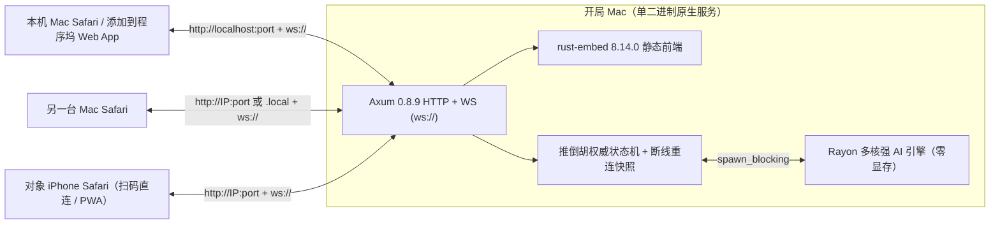

# Rust 优先的 2D 局域网麻将技术栈与跨端方案调研报告

> **调研范围**：Ticket #3（Wayfinder 技术选型调研）  
> **核验基准日期**：2026 年 11 月（所有版本与兼容性结论均基于一手官方文档、规范、Issue Tracker 与包仓库事实核验）  
> **适用约束**：家庭局域网 4 人推倒胡（1 人 + 3 AI 或双人 + 2 AI）、仅覆盖 Apple 生态（Mac 桌面主玩 + 同局域网 iPhone 随开随玩）、优先尝试 Rust（规则/强 AI/服务）、禁用 Electron、默认由开局 Mac 启动（兼顾单二进制轻量迁移至 NAS / Mac mini）、2D《双城之战》漫画风格（反 3D）、强本地零显存依赖 AI。

---

## 1. 执行摘要与推荐结论

### 1.1 最终推荐结论

**首推路线 1（Rust 权威服务端 + 现代 Web 2D 前端，单二进制零安装直连）：**

- **权威后端 & 单二进制载体**：**Rust + Axum `0.8.9`（Tokio）+ 原生 WebSocket（`ws://`）+ Rayon 并发 AI 思考池 + `rust-embed 8.14.0`**。
  - 编译为单个独立可执行文件：开局 Mac 一键启动后自动唤醒本机浏览器（或使用 Safari「添加到程序坞」作为类原生桌面应用），另一台 Mac 与 iPhone 扫局域网二维码 / 访问 `http://<MacName>.local:<port>` 零安装即刻加入；未来迁移至家庭 Mac mini 或 Linux NAS 常驻只需直接运行同一编译架构二进制，零架构割裂。
- **2D 漫画风格渲染与 UI 叠层**：**PixiJS `v8.23.0`（WebGL2 默认 + 可选 WebGPU）+ Svelte `5.59.x`（或 Solid `2.0`）DOM 叠层 HUD + 原生 WebAudio**。
  - 麻将桌牌面、出牌动效、漫画半调网点（halftone）/描边（outline）/颗粒（grain）等后处理由 PixiJS v8 `Filter` 与自定义 GLSL/WGSL `Shader` 承担；新手教学弹窗、汉字提示、规则设置、断线重连浮层交给 HTML/CSS/SVG DOM，直接复用 macOS/iOS 原生中文字体栈（`PingFang SC` / `-apple-system`），彻底规避游戏引擎的数十 MB 中文字库打包与排版泥潭。
- **传输协议**：**坚定选择原生 WebSocket（`ws://` over HTTP），明确放弃 WebTransport 与冗余 Rust-to-WASM 规则共享**。
  - 尽管 Apple 已在 **Safari 26.4（2026-03-24）** 上线 WebTransport，但其强制要求 W3C `[SecureContext]`（局域网纯 `http://` 页面不可用，强制 HTTPS 又面临自签 Root CA 安装或 `serverCertificateHashes` 每 ≤14 天轮换约束），且 WebKit 存在流控窗口耗尽卡死缺陷（Bug **#317084** / **#319818**）。

### 1.2 为什么不选其他候选路线（一票否决/降级依据）

| 候选路线 | 结论 | 核心排除原因（均基于一手事实） |
| :--- | :--- | :--- |
| **路线 1：Rust (Axum + WS) + PixiJS v8 + Svelte 5/Solid 2** | **强烈推荐（首选）** | 满足单二进制、Mac + iPhone 零安装、Rayon 强 AI 无阻塞、漫画 Shader、后续无缝迁移 NAS，Apple 生态兼容陷阱最少且可控。 |
| **路线 2：Tauri v2 (`2.12.6`) + 内嵌 HTTP/WS** | **不作为 Phase 1 首选（可作 Phase 2 可选轻壳）** | 生产版自定义协议（`tauri://localhost` / `https://tauri.localhost`）向本地 `ws://127.0.0.1` 建连会触发 `WKWebView` **W3C Mixed Content 拦截**（ATS `NSAllowsLocalNetworking` 无法绕过），迫使本地与局域网通信割裂；叠加未付费公证 Gatekeeper 报「已损坏」弹窗、`NSLocalNetworkUsageDescription` 配置摩擦、以及近年 macOS `WKWebView` 合成器冻结（`wry#1848`）与 WebGPU 开关限制（`tauri#6381`）。 |
| **路线 3a：Bevy 2D (`0.20`) / Macroquad 全端** | **明确否决** | **Bevy 0.20** WASM 产物即使极度压缩仍达 **10–20+ MB（3.5–5+ MB gzip）**，iOS Safari 易因 WASM 堆与并发纹理加载触发内存 OOM 崩溃；**Macroquad** 虽小（~300–800 KB）但缺乏现成 UI 布局引擎、默认字体仅支持 ASCII（中文需手工 `load_ttf_font` 与字形图集管理），双端新手教学 HUD 研发效率远逊 Web DOM。 |
| **路线 3b：Rust 核心编译 WASM 共享给 Web 前端** | **Phase 1 否决（YAGNI）** | 麻将洗牌、牌山、他家手牌属于服务端秘密状态，绝不能下发前端；前端所需的听牌/向听数/可吃碰杠提示随服务端回合包下发即可。引入 `wasm-bindgen`（注：原 `rustwasm` WG 已于 2025-09 归档）只会增加双端构建链路与胶水包体，无实际收益。 |
| **路线 4：Bun (`1.4.5`) + TypeScript 全栈基线** | **保留为退路对照（不如 Rust 首选）** | `Bun.serve` WebSocket 研发最快，但 `bun build --compile` 单二进制起步即 **57–65+ MB**，且强 AI（百毫秒级 MCTS/多核搜索）在单线程 JS 事件循环上会阻塞房间心跳，若用 `bun:ffi` / `napi-rs` 桥接 Rust 则同时丧失纯 TS 简单性与零封送开销。 |

---

## 2. 候选技术路线多维横向对比

| 评估维度 | 路线 1：Rust (Axum+WS) + PixiJS v8 + Svelte 5/Solid 2 | 路线 2：Tauri v2 (`2.12.6`) + 内嵌局域网服务 | 路线 3a：Bevy `0.20` / Macroquad (原生 + WASM) | 路线 3b：Rust Core WASM + Web UI | 路线 4：Bun `1.4.5` + TS 全栈（对照基线） |
| :--- | :--- | :--- | :--- | :--- | :--- |
| **Mac 桌面体验** | 极佳（本机浏览器全屏 / Safari「添加到程序坞」独立 Dock 窗口） | 佳（原生菜单栏/窗口），但需处理未公证拦截与 `WKWebView` 兼容 | 原生窗口极快，但输入法/中文文本排版/桌面控件偏硬 | 同路线 1（但前端冷启动需加载 WASM） | 同路线 1 |
| **iPhone 局域网体验** | **零安装最佳**：扫码即玩，复用原生中文字体、安全区、手势缩放隔离 | 仍需额外走内嵌 HTTP/WS 供 iPhone 浏览器访问，本机与外部传输割裂 | **体验最差**：Bevy WASM 内存易在 iOS OOM；Macroquad 触摸/UI 粗糙 | 增加 iOS 首屏 WASM 下载与内存开销 | 同路线 1 |
| **2D 漫画风格 & Shader** | **极强**：PixiJS v8 `Filter` + GLSL/WGSL 双管线，DOM 完美叠加漫画气泡 | 取决于系统 `WKWebView`（受限且有 `wry#1848` 冻结风险） | Bevy `Material2d`(WGSL) / Macroquad `load_material`(GLSL) 强，但 UI 痛 | 同路线 1 | 同路线 1 |
| **强 AI 集成摩擦** | **零摩擦**：服务端进程内直接调用 Rust AI + Rayon 多核并行，不阻塞 Tokio | **零摩擦**（同 Rust 核心），但需管理 GUI App Nap | 原生极佳，但若共用 WASM 无法直接跑重多线程 | 多出 `wasm-bindgen` 类型桥接与序列化成本 | **高摩擦**：单线程 JS 阻塞，需 Worker 池或 `bun:ffi`/`napi-rs` |
| **单二进制 & NAS 迁移** | **最优**：`rust-embed` 内嵌静态资源，无 JS 运行时/浏览器内核冗余，单二进制通吃 Mac 与 NAS | **割裂**：`.app` 为桌面 GUI 产物，NAS 部署需另拆分独立 headless binary | 原生二进制+静态资源打包需分平台编译，WASM 分发仍需 HTTP 服务 | 仍需静态构建流水线增加一道 `wasm-pack` | 单二进制可用（`bun build --compile`），但基线体积 **57–65+ MB** |
| **研发效率与维护成本** | **高**：前后端分工清晰，Web 生态调试极其成熟，AI 逻辑纯 Rust 单测 | **中**：需额外踩 Tauri Capabilities、ATS、Mixed Content、苹果签名坑 | **低**：全游戏引擎重造中文 UI 与教学弹窗性价比极低 | **中低**：多维护一套 WASM 构建与胶水层 | **最高**（若无需重度原生 AI），否则仍需 Rust FFI |

---

## 3. 关键技术细节与一手踩坑核实

### 3.1 传输层决策：WebSocket (`ws://`) vs WebTransport（为何 2026 年局域网仍选 WebSocket）

1. **Safari / WebKit 的 WebTransport 最新支持现状**：
   - 根据 Apple 官方 Safari 26.4 发布说明（2026-03-24）与 WebKit 官方博客，**Safari 26.4** 正式新增了对 **WebTransport** 的支持（参考编号 `165721145`），使其跨入全浏览器覆盖（Interop 2026 / Baseline 2026）[1][2]。
   - 规范层面，WebTransport 支持通过 `serverCertificateHashes` 传入 SHA-256 哈希以绕过公共 CA 信任链连接自签名服务端（Rust 端对应 crate 为 `wtransport v0.7.2`）[3][4]。
2. **四个阻止局域网麻将采用 WebTransport 的一手实锤坑点**：
   - **坑点一：`[SecureContext]` 死锁**：W3C WebTransport 规范明确将其 WebIDL 接口标记为 `[Exposed=(Window,Worker), SecureContext]`[3]。家庭局域网通过 `http://192.168.x.x:8080` 或 `http://mac.local:8080` 打开时，页面**不是安全上下文（`isSecureContext === false`）**，`WebTransport` 构造函数直接不可用。若强行上 HTTPS，家庭用户在 iPhone 上要么手动安装并信任自签根证书，要么每次面对浏览器证书警告，或者通过扫码传递 `serverCertificateHashes` 且必须遵守浏览器对自签证书 **≤14 天有效期** 的强制上限并持续轮换证书。
   - **坑点二：WebKit 已知流控永久卡死 Bug**：在 WebKit Bugzilla 上，**Bug 317084**（*"Safari WebTransport stalls permanently at QUIC connection MAX_DATA with many incoming unidirectional streams"*）与 **Bug 319818**（*"[WebTransport] Flow control never refills"*）确认了 Safari 的 WebTransport 实现存在接收流消费完成后未能向 QUIC 层正确回补连接级流控额度（如 16 MiB `MAX_DATA` 或 `MAX_STREAMS`）的问题，会导致长连接在耗尽窗口后静默卡死[5][6]。
   - **坑点三：系统版本强绑定**：未升级至 iOS 26.4 / macOS 26.4 及以上版本的家庭旧设备完全无法使用 WebTransport。
   - **坑点四：协议语义过剩**：麻将是低频（每秒 0~数条小数据包）、严格要求可靠有序投递的回合制状态机，QUIC 的不可靠 Datagram 与多流消解队头阻塞毫无用武之地，反而引入 UDP/TLS 复杂度。
3. **WebSocket 结论**：
   - Rust 后端直接采用 **`axum v0.8.9`** 内置的 `WebSocketUpgrade`（支持子协议协商 `requested_protocols` / `set_selected_protocol`）[7]。
   - 在局域网纯 `http://` 页面下发起同源 `ws://` 连接**完全符合 W3C Mixed Content 规范，不会被 Safari 拦截**（仅当父页面为 `https://` 时发起 `ws://` 才会被判定为 Mixed Content 阻断）[8]。

---

### 3.2 Apple 生态运行时踩坑实录（iOS Safari / macOS Safari / WKWebView / App Nap）

#### 1) iOS Safari 切后台 / 锁屏导致 WebSocket「僵尸连接」
- **一手行为**：iOS WebKit 在 Safari 退入后台或锁屏后会迅速挂起页面 JS 执行并休眠网络；更棘手的是，TCP/WebSocket 在休眠期间断开时，**iOS Safari 恢复前台后往往不会立即触发 `onclose` 或 `onerror`**，`WebSocket.readyState` 仍错误停留在 `WebSocket.OPEN`（僵尸状态），后续发包静默失败。
- **必须实现的抗断连架构**：
  1. **不能信任 `onclose`**：监听 `document.visibilitychange`，一旦 `document.visibilityState === 'visible'`，立即向服务端发一帧应用层 `Ping`；若未在短超时（如 1.5–2 秒）内收到 `Pong`，直接判定为僵尸连接并主动 `.close()` 后重建连接。
  2. **牌局保活防息屏**：调用 Screen Wake Lock API（`navigator.wakeLock.request('screen')`）。注意历史上 **WebKit Bug 254545** 曾导致 iOS 16.4 起的「主屏幕 PWA」中 Wake Lock 失效，该问题已在后续 iOS 版本（iOS 18.4 周期）修复[9]；但因 iPhone 仍可能来电/切微信，**后端必须实现断线重连（Seat Token + 服务端权威全量状态快照重同步 State Snapshot Resync）**，保证 iPhone 切回瞬间 100% 恢复当前牌局而不丢回合。
  3. **`pagehide` 清理**：使用 `pagehide` 替代不可靠的 `unload` 主动发送优雅关闭帧，方便服务端第一时间标记玩家暂时离线并托管或等待回连。

#### 2) Apple Local Network Privacy（TN3179）与 Mixed Content / ATS 陷阱
- **Safari 浏览器路径（路线 1）**：依据 Apple 技术文档 **TN3179 (*Understanding local network privacy*)**，作为普通局域网 Web 客户端在 Safari 中打开局域网服务 IP 或 `.local` 由系统浏览器统一承载，开发者无需打包 `.app` 申请本地网络权限；而由 Mac 终端或 `launchd` 启动的服务端监听入站连接属于服务端监听行为（且可绑定内网网卡），不触发原生 App 出站探测弹窗困扰[10]。
- **原生壳路径（路线 2：Tauri v2）的典型双坑**：
  1. **本地网络权限与沙盒**：打包 `.app` 若做主动局域网出站/mDNS 发现，必须在 `Info.plist` 配置 `CFBundleIdentifier` 与 `NSLocalNetworkUsageDescription`，否则在现代 macOS 上会静默失败或抛出 `EHOSTUNREACH` / `FailedToOpenSocket`[10]；若开启 App Sandbox，还必须在 `Entitlements.plist` 声明 `com.apple.security.network.server` 与 `com.apple.security.network.client`。
  2. **`tauri://localhost` 与 `ws://127.0.0.1` 的 Mixed Content 冲突**：Tauri v2 生产构建通常从安全自定义上下文（如 `tauri://localhost` 或 `https://tauri.localhost`）加载前端。`WKWebView` 严格遵循 W3C Mixed Content 规范，会**直接拦截页面内对 `ws://127.0.0.1:<port>` 的建连**；且 Apple 官方已明确 **`NSAppTransportSecurity`（`NSAllowsLocalNetworking` 等）仅作用于原生网络栈，无法覆盖 WebKit 的 W3C Mixed Content 策略**[8]。Tauri 官方推荐改用 `@tauri-apps/plugin-websocket`（由 Rust 代理建连）或全部走 `tauri::invoke` IPC[11]——但这会导致本机 Mac 客户端走 Tauri IPC/Plugin、另一台 Mac 与 iPhone 走原生浏览器 `WebSocket`，同一前端被迫维护两套传输适配层！

#### 3) macOS App Nap 节流问题
- 若服务以 CLI 进程或 `launchd` 服务运行，默认不触发 GUI App Nap 冻结；
- 但若日后给开局 Mac 包装成带菜单栏图标（`tray-icon`）的 GUI 原生应用且窗口被隐藏/最小化时，macOS 会开启 **App Nap** 大幅降低定时器频率、延后 Socket 响应并限制 CPU 时间片。此时必须通过 Foundation `ProcessInfo.beginActivity(options:reason:)` 申请 `.userInitiated`（或组合 `.idleSystemSleepDisabled`）并在服务端生命周期内**持久持有返回的 activity token**（`NSActivityBackground` **无法**阻止 App Nap 节流网络与定时器）[12]。

#### 4) Tauri v2 / `WKWebView` 额外桌面稳定性隐患
- **WebGPU 与渲染冻结**：虽然 Apple 在 **Safari 26**（macOS Tahoe / iOS 26）起默认开启 WebGPU[13][14]，但嵌入式 `WKWebView` 历史上不向宿主暴露实验功能开关 API（`tauri#6381`）[15]，且 `wry` 在近年 macOS 上曾出现合成器帧冻结黑屏/停滞但 DOM 仍响应的缺陷（`wry#1848`）[16]。
- **未公证 Gatekeeper 拦截**：无付费 Apple Developer ID（$99/年）签名的 Tauri `.app` 在另一台 Mac 上分发打开时易触发 Gatekeeper 提示「已损坏，无法打开」，需手动执行 `xattr -cr` 清除隔离属性；而直接用浏览器访问则零签名成本。

---

### 3.3 2D 漫画风格化渲染、Shader 与 UI 框架选型

#### 1) PixiJS v8 (`v8.23.0`) vs Canvas 2D vs Bevy `0.20` vs Macroquad

| 维度 | PixiJS `v8.23.0` | 原生 Canvas 2D | Bevy `0.20` (2D) | Macroquad (`miniquad`) |
| :--- | :--- | :--- | :--- | :--- |
| **渲染后端** | 统一 **WebGPU + WebGL2**（`autoDetectRenderer` 自动回退）[17] | CPU / 浏览器 2D 光栅化 | `wgpu`（原生 Metal；WASM 可选 `webgl2` / `webgpu`）[18] | `miniquad`（原生 Metal/GL3；WASM 为 WebGL 1/2）[19] |
| **漫画 Shader 能力** | **极佳**：内置 `BlurFilter`/`NoiseFilter`/`ColorMatrixFilter` + 自定义 `Filter`（`GlProgram` GLSL + `GpuProgram` WGSL），支持为重滤镜单设 `resolution = 0.5` 降负[17][20] | **极弱**：无实时片段着色器，像素滤镜靠 `ImageData` 极慢，难以做网点/动态描边/光晕 | **极强**：`Material2d` + WGSL/WESL 节点与全屏后处理[21] | **中等**：`load_material` 手写 GLSL，API 极简但缺现代管线抽象[22] |
| **产物与 iOS 内存** | 单包 tree-shaking 后 JS 仅数百 KB；内存可控 | 零额外运行时 | **高危**：压缩后 WASM 仍 **10–20+ MB（3.5–5+ MB gzip）**，iOS Safari 并发载入纹理极易 OOM 崩溃[23] | 极轻量（WASM 约 **300–800 KB**）[24] |
| **中文（CJK）排版与 UI** | **完胜**：PixiJS 专心画牌桌/特效，教学弹窗/HUD 走 HTML/CSS 原生字体栈（零字体体积） | 同左（搭配 DOM） | **痛点**：`bevy_ui` 排版/输入框弱，中文字库需额外打包数 MB 子集字体且不易动态热补 | **严重痛点**：默认字体仅 ASCII，中文必须 `load_ttf_font` 并自管纹理图集与防溢出血 |
| **音频与 iOS 细节** | WebAudio（首次点击解锁）+ `v8.23.0` 新增 `safariFontDelay` 修复 Safari `HTMLText` 字体延迟绘制[25] | 原生 WebAudio | `bevy_audio` / `cpal` 在 WASM 下易引发移动端高频 GC 卡顿[26] | `quad-snd` 在 iOS Safari 需严格绑定点击手势，且 `.ogg` 兼容性差建议转 `.wav` |

**落地提示**：在 PixiJS v8 初始化时，建议默认采用 `preference: 'webgl'`（或基于特征探测/Safari 26+ 按需开启 `'webgpu'` 并保留 WebGL2 自动回退），确保在家庭新旧 Mac/iPhone 上获得 100% 一致的零黑屏体验，同时通过 `resolution: window.devicePixelRatio` 与 `autoDensity: true` 跑满 Retina 视网膜清晰度。

#### 2) DOM UI 叠层框架：Svelte 5 vs Solid 2.0 vs React 19
- **当前稳定生态**：
  - **Svelte `5.59.x`**：Runes 细粒度编译期响应式，无虚拟 DOM diff 开销，运行时极小，与 PixiJS 独立游戏循环并行时几乎不抢占主线程帧时间[27]。
  - **Solid `2.0`**：无虚拟 DOM、原生细粒度信号与一等异步（2026 年 11 月已发布稳定版 2.0），同样非常适合高频局部 HUD 更新[28]。
  - **React `19.3.x`**：生态最庞大、AI 辅助生成 UI 代码容错率最高；但运行时较大，与 PixiJS 混用时需注意将高频状态隔离在外部 Store（不把 60fps 坐标塞进 React state）[29]。
- **结论**：若偏好极简体积与极致丝滑动画叠层，**首选 Svelte 5**（或 Solid 2.0）；若开发团队最熟悉 React 19，采用外部 Store + 仅在回合变化时刷新 DOM HUD 也完全胜任。

---

### 3.4 局域网发现（mDNS / Bonjour）与单二进制打包策略

1. **为什么 Apple 生态局域网解析天生友好（及路由器陷阱）**：
   - macOS 与 iOS 系统底层的 **`mDNSResponder`** 原生接管 UDP `5353` 端口与 `.local`（RFC 6762）组播域名解析。
   - **关键事实**：即使不引入任何第三方 mDNS crate，开局的 Mac 本机在系统网络里本身就拥有 `<Mac主机名>.local`（可通过本机 hostname 获取）。同局域网的另一台 Mac 与 iPhone 在 Safari 地址栏直接访问 `http://<Mac主机名>.local:<port>`，iOS `mDNSResponder` 就会原生解析出内网 IP 并发起 HTTP 连接。
2. **`mdns-sd` vs `async-dnssd` 对比**：
   - **`mdns-sd`（`v0.22.0`）**：纯 Rust 实现、无异步运行时强制绑定，通过 `SO_REUSEADDR`/`SO_REUSEPORT` 与系统 `mDNSResponder` 共享 UDP 5353 端口；可用于在局域网广播自定义服务名或 `_http._tcp.local.`（注：在存在 Docker 虚拟网卡、多网卡或复杂接口切换的 macOS 上，纯用户态监听 5353 需谨慎过滤非物理网卡接口）[30]。
   - **`async-dnssd`（`v0.5.1`）**：通过 FFI 调用苹果原生 `dns_sd.h`，直接委托系统 `mDNSResponder` 广播服务，在 macOS 上零端口冲突；但若将来交叉编译部署至 Linux NAS 会强依赖 `libavahi-compat-libdnssd` 动态库，破坏单二进制无外部依赖的简洁性[31]。
3. **家庭 Wi-Fi 零失败接入方案（实操推荐）**：
   - 不少家用路由器/Mesh Wi-Fi 会在访客网络或 2.4G/5G 跨频段开启 **AP Isolation（客户端隔离）** 或丢弃 mDNS 组播包，导致 `.local` 偶尔解析失败。
   - **最佳工程实践**：服务端启动后自动探测本机局域网 IPv4（如 `192.168.x.x`）与 `<hostname>.local`，在终端及开局 Mac 网页大厅里**同时生成直观的局域网扫码二维码（优先内网 IP URL，辅以 `.local` 备选）**。对象拿 iPhone 相机直接一扫即开，既省去手输 IP 麻烦，又免疫路由器 mDNS 组播丢包。
4. **单二进制资源内嵌**：
   - 使用 **`rust-embed` `v8.14.0`**（或 `include_dir v0.7.4`）将前端 Vite 编译产物打包进 Rust 服务端二进制，通过 Axum 路由兜底直接响应静态资源与正确 MIME 类型及缓存头[32][33]。开发期开启 `debug-assertions` 时直接读取磁盘热更新目录，Release 编译期内嵌为不含外部 JS 运行时/浏览器内核的单个原生可执行文件（最终体积主要由自研代码与内嵌牌面贴图/音效资源决定）。

---

### 3.5 强麻将 AI 集成与 Rust-to-WASM / Bun 基线对比

1. **为什么强 AI 放在 Rust 服务端是压倒性优势**：
   - 家庭推倒胡强 AI（如不完全信息蒙特卡洛采样 PIMC / ISMCTS + 启发式听牌/防守估值，目标百毫秒级返回最优出牌）高度依赖位运算、紧凑数组与多核并发搜索。
   - 在 **Rust (Axum + Tokio + Rayon)** 架构下：Axum/Tokio 负责轻量网络 I/O 与房间状态机；AI 轮到思考时，通过 `tokio::task::spawn_blocking` 将只读局面快照投递给 **Rayon** 线程池，在 Apple Silicon（M 系列 8~12+ 核）上并行展开数万次模拟，**零显存依赖、几十毫秒出牌、且 100% 不阻塞 WebSocket 心跳与另一位人类玩家的操作**。
2. **为什么不做「Rust 核心编译 WASM 共享给前端」（路线 3b）**：
   - 权威多人桌游中，牌墙剩余序列与他家手牌严禁发送至浏览器，前端不存在独立运行完整麻将引擎或 AI 的需求；向听数、听牌列表、可吃碰杠操作完全由服务端在状态机推进后随下发消息一并附带。
   - 生态方面，原 `rustwasm` GitHub 组织已于 **2025 年 9 月正式归档落幕**（`wasm-bindgen` 已迁出至独立组织 `wasm-bindgen/wasm-bindgen` 并持续维护至 `v0.2.129`，`wasm-pack` 由社区接管至 `0.15.1`）[34][35]。对本项目而言，引入 `wasm-bindgen` 跨边界序列化只会增加额外构建链与维护负担，非必要不引入。
3. **为什么不直接用 Bun + TypeScript 全栈（路线 4）**：
   - Bun（`v1.4.5`）的 `Bun.serve` WebSocket 确实极其高效直观，前后端共享 TypeScript 类型可进一步缩短首版原型周期[36]。
   - 然而，使用 `bun build --compile` 打包单二进制时，因为内嵌完整 JS 运行时，即便空项目起步体量也高达 **57–65+ MB**（即便加实验性 `--trim` 亦显著重于 Rust 原生二进制），且 Apple Silicon 上仍需处理 `codesign --force --sign -` 重签名以防触发 `SIGKILL`[37][38]。更核心的是，重度 AI 搜索若用纯 TS 写会受限于单线程事件循环与 GC 停顿；若改用 `bun:ffi` / `napi-rs` 调 Rust 动态库，不仅每次跨语言封送复杂牌局状态产生额外开销与内存边界风险，还丢失了纯 TS 架构的简洁性，最终「既要写 Rust 又要管 Bun 跨语言胶水」，得不偿失。

---

## 4. 推荐架构落地蓝图与演进路径

1. **Phase 1（MVP 到主力游玩形态）**：
   - **后端**：单个 Rust 二进制（Workspace 拆为 `mahjong-core` 规则与数据结构、`mahjong-ai` 独立强 AI 与 benchmark、`mahjong-server` Axum + `rust-embed` + 终端/页面二维码生成器）。
   - **前端**：Vite + TypeScript + **PixiJS `v8.23.0`**（漫画材质、半调/描边 Shader、牌桌动效）+ **Svelte `5.59.x`**（大厅、新手辅助提示、音效管理、断线重连 HUD）。
   - **桌面优化**：开局 Mac 启动后自动打开浏览器，在 Safari 中点击「文件 → 添加到程序坞」即可拥有独立 App 图标、无地址栏窗口与独立 Cmd+Tab 体验，**零 Electron、零 Tauri 签名与混合内容麻烦**。
2. **Phase 2（平滑演进预留）**：
   - **常驻家庭服务器**：同一 Rust 项目交叉编译为 `aarch64-unknown-linux-gnu` / `musl` 或直接跑在 Mac mini 上，配合 `launchd` / `systemd` 即成 7×24 家庭麻将房，前后端代码一行不改。
   - **若未来强需求原生系统托盘/快捷键**：只需额外加一个极薄 macOS 托盘启动器（显式调用 `ProcessInfo.beginActivity` 防 App Nap）拉起同一服务并指向本机浏览器即可，无需把核心渲染塞进有帧冻结风险的 `WKWebView`。

---

## 5. 一手权威来源引用

1. Apple Developer — Safari 26.4 Release Notes（确认 WebTransport 于 2026-03-24 随 Safari 26.4 发布，`165721145`）：<https://developer.apple.com/documentation/safari-release-notes/safari-26-4-release-notes>
2. WebKit Blog — *WebKit Features for Safari 26.4*：<https://webkit.org/blog/17862/webkit-features-for-safari-26-4/>
3. W3C WebTransport Specification（确认 `[Exposed=(Window,Worker), SecureContext]` 与 `serverCertificateHashes` 规范）：<https://w3c.github.io/webtransport/>
4. crates.io — `wtransport` (`v0.7.2`) & GitHub 源码仓库：<https://crates.io/crates/wtransport> / <https://github.com/BiagioFesta/wtransport>
5. WebKit Bugzilla — Bug 317084 (*Safari WebTransport stalls permanently at QUIC connection MAX_DATA with many incoming unidirectional streams*)：<https://bugs.webkit.org/show_bug.cgi?id=317084>
6. WebKit Bugzilla — Bug 319818 (*[WebTransport] Flow control never refills*)：<https://bugs.webkit.org/show_bug.cgi?id=319818>
7. GitHub & crates.io — `tokio-rs/axum`（`v0.8.9` 发布与 `WebSocketUpgrade` 特性）：<https://github.com/tokio-rs/axum> / <https://crates.io/crates/axum>
8. W3C Mixed Content 规范 & Apple `NSAppTransportSecurity` 官方文档（说明 `https://` 下 `ws://` 被拦截及 ATS 仅限原生网络栈）：<https://w3c.github.io/webappsec-mixed-content/> / <https://developer.apple.com/documentation/bundleresources/information_property_list/nsapptransportsecurity>
9. WebKit Bugzilla — Bug 254545 (*New Wake Lock API does not work in Home Screen Web Apps*)：<https://bugs.webkit.org/show_bug.cgi?id=254545>
10. Apple Developer Technical Note TN3179 — *Understanding local network privacy*：<https://developer.apple.com/documentation/technotes/tn3179-understanding-local-network-privacy>
11. Tauri v2 Releases (`v2.12.6`) & WebSocket Plugin Docs：<https://github.com/tauri-apps/tauri/releases> / <https://v2.tauri.app/plugin/websocket/>
12. Apple Developer Documentation — `ProcessInfo.beginActivity(options:reason:)`（macOS App Nap 抑制规范）：<https://developer.apple.com/documentation/foundation/processinfo>
13. Apple Developer — Safari Release Notes（Safari 26.0 原生默认开启 WebGPU 与 HDR 支持及 Safari 27.x 修复）：<https://developer.apple.com/documentation/safari-release-notes>
14. WebKit Blog（WebKit 官方 WebGPU 演进与 Safari 26 默认启用说明）：<https://webkit.org/blog/>
15. GitHub Issue `tauri-apps/tauri#6381`（Tauri / `WKWebView` WebGPU 实验标志控制受限问题）：<https://github.com/tauri-apps/tauri/issues/6381>
16. GitHub Issue `tauri-apps/wry#1848`（macOS `WKWebView` 合成器帧冻结停滞问题）：<https://github.com/tauri-apps/wry/issues/1848>
17. PixiJS v8 官方指南（WebGL2 / WebGPU 渲染器与 Shader/Filter 双管线、`v8.23.0`）：<https://pixijs.com/8.x/guides/components/rendering/webgl-and-webgpu> / <https://github.com/pixijs/pixijs>
18. Bevy 0.20 官方发布日志 & GitHub Releases（`Material2d` / WASM 支持）：<https://bevy.org/news/bevy-0-20> / <https://github.com/bevyengine/bevy/releases>
19. Macroquad & Miniquad 官方仓库（Metal/OpenGL 后端及 `miniquad#697`）：<https://github.com/not-fl3/macroquad> / <https://github.com/not-fl3/miniquad> / <https://github.com/not-fl3/miniquad/issues/697>
20. PixiJS v8 Introduction：<https://pixijs.com/8.x/guides/getting-started/introduction>
21. Bevy 引擎仓库（WGSL / `Material2d` 生态）：<https://github.com/bevyengine/bevy>
22. Macroquad `load_ttf_font` / `load_material` 官方仓库：<https://github.com/not-fl3/macroquad>
23. Bevy WASM 大小与 iOS 内存约束参考（Bevy 官方仓库与社区编译指南）：<https://github.com/bevyengine/bevy/releases>
24. Macroquad WASM 轻量产物参考：<https://github.com/not-fl3/macroquad>
25. PixiJS `v8.23.0` Releases（`safariFontDelay` 与 Safari 兼容修复）：<https://github.com/pixijs/pixijs/releases>
26. Bevy WASM WebAudio 限制参考：<https://github.com/bevyengine/bevy>
27. Svelte Releases (`v5.59.x`)：<https://github.com/sveltejs/svelte/releases>
28. SolidJS Releases (`v2.0`)：<https://github.com/solidjs/solid/releases>
29. React Releases (`v19.3.1`)：<https://github.com/facebook/react/releases>
30. crates.io — `mdns-sd` (`v0.22.0`)：<https://crates.io/crates/mdns-sd>
31. crates.io — `async-dnssd` (`v0.5.1`)：<https://crates.io/crates/async-dnssd>
32. crates.io — `rust-embed` (`v8.14.0`)：<https://crates.io/crates/rust-embed>
33. crates.io — `include_dir` (`v0.7.4`)：<https://crates.io/crates/include_dir>
34. Inside Rust Official Blog — *Sunsetting the rustwasm GitHub org*（2025-07-21 公告，2025-09 归档）：<https://blog.rust-lang.org/inside-rust/2025/07/21/sunsetting-the-rustwasm-github-org/>
35. GitHub — `wasm-bindgen` 独立仓库（`v0.2.129`）：<https://github.com/wasm-bindgen/wasm-bindgen>
36. Bun WebSockets 官方文档（`Bun.serve`）：<https://bun.sh/docs/api/websockets>
37. Bun Executables 官方文档（`bun build --compile` 与 macOS `codesign`）：<https://bun.com/docs/bundler/executables>
38. GitHub Issue `oven-sh/bun#14546`（`bun build --compile` 基线体积 ~57–65+ MB）：<https://github.com/oven-sh/bun/issues/14546>
