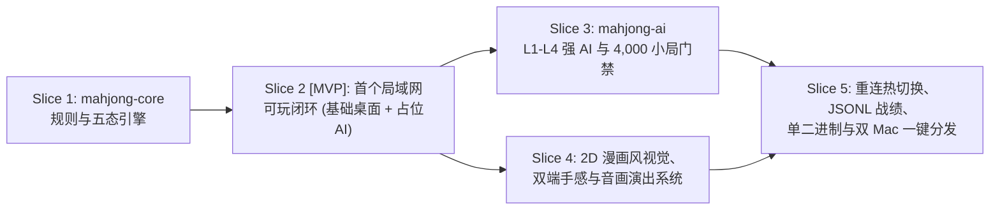

# 麻将牌局（Majjj）v1 完整架构与游戏设计规格

> - **文档状态**：v1 定稿（可直接进入工程实施）
> - **领域词汇权威**：[GLOSSARY.md](../../GLOSSARY.md)（34 项规范词条；本文及代码标识严格遵守其命名边界）
> - **架构决策索引**：[ADR-0001](../adr/0001-rust-single-binary-server-and-web-2d-client.md) ～ [ADR-0007](../adr/0007-server-paced-presentation-semantic-av-hooks-and-safari-safeguards.md)
> - **视觉原型归档**：分支 `prototype/comic-table-ui`（[`web/prototype-comic-table`](https://github.com/highing666/majjj/tree/prototype/comic-table-ui/web/prototype-comic-table)，仅作一级抛弃型参考）
> - **前置一手调研**：`research/tech-stack-comparison`、`research/mahjong-ai-algorithms`、`research/comic-2d-visual-audio`

本文档是 `Majjj` v1 唯一自包含的权威执行规格，聚焦**功能契约、数据边界、时序协议、算法架构、实施切片与验收门禁**；各项不可逆选型的背景权衡与被否决方案详见对应 ADR。

---

## 第 1 章：产品目标、运行范围与明确非目标

### 1.1 产品定位与运行目标

`Majjj` 是一款面向家庭局域网的 **4 人标准推倒胡麻将游戏**，重点服务双人日常居家游玩与单人练牌场景：

- **局域网对局形态**：优先打磨 `1P + 3 AI` 与 `2P + 2 AI` 体验；底层牌桌与引擎自然支持 `1–4` 名人类入座，空余座次由 AI 自动补位。
- **宿主机与终端拓扑**：以双台 Apple Silicon Mac 作为完全对等的宿主机与首选桌面端（重点严守 **8GB 统一内存**约束），同时确保局域网内 iPhone 通过 Safari 零安装扫码即开；单二进制保留无头参数，可零改造迁往 Mac mini 或 Linux NAS 常驻。
- **核心体验支柱**：
  1. **有压迫感的纯 CPU 推倒胡强 AI**：高牌效、结合非立直危险度模型的防守避炮推理与择机浅层博弈搜索，无本地 LLM 与神经网络开销。
  2. **2D 漫画厚涂风格化牌桌**：参考《英雄联盟：双城之战》的暖琥珀聚光、深青绒布、墨线描边与碰撞冲击质感，保持 34 种牌面在 Mac 与 iPhone 上清晰易辨。
  3. **对象零门槛启停与更新**：本机通过极薄 `.app` 启动器点击即开、分状态空闲自动退服；双机通过局域网 SSH 无隔离一键推送更新。
  4. **平滑演进扩展口**：引擎层经轻量 `Ruleset` 预留`吃`牌与更多麻将玩法扩展口；表现层经 `SemanticGameEvent`、`SeatInfo.voice_pack_id` 与 `PresentationEffectsBus` 预留 v2 角色配音包与进阶特效钩子。

### 1.2 明确非目标（Out of Scope）

以下能力明确排除在 v1 交付范围外：

1. **非 Apple 平台适配**：不支持 Windows、Linux 桌面端与 Android 设备（仅服务端源码保持对 Linux NAS 无头部署的纯 Rust 跨平台兼容）。
2. **3D 牌桌与重度 3D 资产**：v1 及后续规划坚持 2D 漫画风格，不做 3D 渲染。
3. **Electron 桌面框架**：明确禁用 Electron。
4. **完整角色配音包、精细角色立绘与重度过场动画**：v1 仅交付基础音效与语义扩展钩子，正式配音包与高成本动画留待 v1 之后。
5. **非推倒胡玩法实现**：v1 仅实现推倒胡（四川血战、日麻、国标等玩法留待后续通过 `Ruleset` 扩充）。
6. **深度学习/强化学习自博弈训练与本地 LLM 陪玩**：v1 强 AI 专注纯 CPU 传统博弈算法，不引入 ML 训练管线与大语言模型对话。
7. **公网联机与重度社交周边**：不包含账号注册登录、公网穿透/中继、逐手对局录像与观战、局内文字/语音聊天及防作弊客户端校验。
8. **局内新手辅助提示**：v1 局内严禁提供听牌提示、实时叫胡列表、剩余可见张数统计或 AI 荐牌（仅保留`小局`结算页的基础番型名称与得分/`杠分`明细）。
9. **iPhone 无宿主机独立离线单人游玩**：iPhone 定位为纯浏览器瘦客户端，须连接运行中的 Mac 或常驻宿主机，不将规则引擎或强 AI 编译下发至客户端。

---

## 第 2 章：推倒胡精确规则与计分契约

本章全部概念与规则定稿自 [GLOSSARY.md](../../GLOSSARY.md) 与规则决策记录，为 `mahjong-core` 的唯一规则真值表。

### 2.1 牌库构成与标准编码

- **牌库规模**：**136 张**标准无花无赖子牌库：
  - **数牌**（108 张）：万（1–9 万）、条（1–9 条）、筒（1–9 筒），每种各 4 张。
  - **字牌**（28 张）：风牌（东、南、西、北）与箭牌（中、发、白），每种各 4 张。
- **规范 `Tile(u8)` 索引编码（`0..34`）**：与 `mahjong-ai` 的 `[u8; 34]` 频数数组直接一一对齐：

| 索引区间 | 牌类 | 顺序映射 |
| --- | --- | --- |
| `0..=8` | 万子 | 一万 (`0`) ～ 九万 (`8`) |
| `9..=17` | 条子 | 一条 (`9`) ～ 九条 (`17`) |
| `18..=26` | 筒子 | 一筒 (`18`) ～ 九筒 (`26`) |
| `27..=30` | 风牌 | 东 (`27`)、南 (`28`)、西 (`29`)、北 (`30`) |
| `31..=33` | 箭牌 | 中 (`31`)、发 (`32`)、白 (`33`) |

### 2.2 起手、动作流转与优先级

- **起手发牌**：
  - 开桌第 1 `小局`随机定东家作为初始`庄家`。
  - 每`小局`庄家起手 **14 张**并先行出牌，其余三家`闲家`各 **13 张**。
  - `庄家`起手 14 张若已满足合法胡牌牌型，可直接宣布`自摸`（按牌面实际`番`型计分，**无天胡特例番**），亦可在首回合直接宣布`暗杠`。
  - `庄家`起手 14 张的首张`舍牌`恒记为**手切**（`is_tsumogiri = false`）。
- **允许动作**：
  - v1 推倒胡**禁止吃牌**，仅允许`碰`、`明杠`、`补杠`、`暗杠`及胡牌（`自摸`、`点炮`、`抢杠胡`）。内核仍为未来扩展玩法内建`吃`动作类型与优先级槽位。
  - **响应优先级**：同一张`舍牌`的响应优先级恒为 **`胡 > 碰 / 明杠 > [预留吃]`**。
  - **一炮多响**：允许单张`舍牌`（含被`抢杠胡`的`补杠`牌）同时使最多三名他家完成`点炮`胡牌，不采用截胡；`点炮者`按各胡牌者`番`型分别独立赔付。
  - **鸣牌后开杠**：`碰`（及未来扩展玩法中的`吃`）后当巡若`牌墙`余牌 `> 0`，当前玩家允许在出牌前直接宣布`暗杠`或`补杠`。
  - **牌墙耗尽边界**：`牌墙`余 **0 张**时**禁止一切开杠**（`明杠`、`补杠`、`暗杠`均不可执行）；最后一张`舍牌`打出后仅允许胡牌（`河底捞鱼`），不可`碰`或`明杠`。
- **抢杠胡规则**：
  - 仅可抢他人宣布的**补杠**（不可抢`暗杠`）。
  - 一旦被`抢杠胡`，本次`补杠`立即作废且**不计该笔`杠分`**；由宣布`补杠`者作为`点炮者`向胡牌者单家赔付（叠加`抢杠胡` `+1` 番，支持`一炮多响`，不设包赔三家特例）。
  - 若所有具`抢杠胡`资格者均选择「过」，则该`补杠`正式成立、计入本小局杠账，并从`牌墙`尾补摸 1 张牌。
- **杠上开花与杠后炮**：
  - 任意`明杠`、`补杠`、`暗杠`从`牌墙`尾补牌后直接`自摸`，均按正常`自摸`三家赔付 + `杠上开花` `+1` 番（不做`明杠`供杠者包赔三家）。
  - 开杠补牌后打出的`舍牌`使他人胡牌，按普通`点炮`结算，不单设杠上炮加番。
- **同巡过水锁定（仅显式选择「过」触发）**：
  - 因更高优先级动作（如他人胡牌）抢断而未及表态，**不计入过水**；仅玩家显式提交「过」动作时触发对应锁定：
  - **`过水胡`**：同一巡内放弃他人`点炮`（含`抢杠胡`）后，直至自己下次从`牌墙`摸牌或执行`鸣牌`（`碰`/`明杠`）之前，**禁止再胡任何他人的`点炮`（含`抢杠胡`）**；在此锁定期间仍允许自己摸牌`自摸`。
  - **`过水碰`**：同一巡内放弃`碰`某张`舍牌`后，直至自己下次摸牌之前，**禁止再`碰`同一张牌**（不影响`碰`其他牌面或胡牌）。

### 2.3 番型表与计分公式

- **起胡门槛与算分公式**：
  - **无起胡门槛**：`自摸`与`点炮`均允许 0 `番`的`基本胡`。
  - 底分固定为 **`1` 分**；单家胡牌基准分 $= 1 \times 2^{\min(\text{总番数},\, 4)}$，**4 番（16×）`封顶`**。
  - `自摸`不另加番（三家分别赔付天然等价于`点炮`的 3 倍总分）。
  - 不计风刻/箭刻（役牌）番，不设天胡/地胡特例番。
- **多拆解与叠加规则**：
  - 同一手牌存在多种合法胡牌拆解时，系统自动取**总`番`数最高**的拆解计分。
  - 上位`番`型取代对应下位`番`型；多组同构牌型不重复累加。
  - 特殊叠加：`牌墙`仅剩最后 1 张时开杠补牌`自摸`，**`杠上开花` + `海底捞月` 可同时叠加计 2 番**（仍受 4 番`封顶`约束）。

| 番数 | 番型名称 | 倍率参考 | 精确判定与互斥条件 |
| --- | --- | --- | --- |
| **0 番** | **基本胡** | `1×` | 满足合法 `4 组面子 + 1 对将牌` 结构，无其余加番项。 |
| **+1 番** | **门前清** | `×2` | 本`小局`未执行过`碰`、`明杠`、`补杠`（`暗杠`不破坏`门前清`）；`七对`、`豪华七对`、`十三幺` **不重复计**`门前清`。 |
| **+1 番** | **碰碰胡** | `×2` | 4 组`面子`全部为刻子或杠子 + 1 对`将牌`。 |
| **+1 番** | **混一色** | `×2` | 整手牌（含已`鸣牌`与`暗杠`）仅由单一花色`数牌`与`字牌`共同构成（且两类皆至少有 1 张）。 |
| **+1 番** | **七对** | `×2` | 门前持有 7 个对子（14 张手牌，无任何`鸣牌`或`暗杠`）；不计`门前清`。 |
| **+1 番** | **杠上开花** | `×2` | `明杠`、`补杠`或`暗杠`后从`牌墙`尾补摸 1 张牌直接`自摸`胡牌。 |
| **+1 番** | **抢杠胡** | `×2` | 胡他人宣布`补杠`的那张牌。 |
| **+1 番** | **海底捞月** | `×2` | 摸取`牌墙`最后 1 张牌直接`自摸`胡牌（含余 1 张开杠补牌自摸）。 |
| **+1 番** | **河底捞鱼** | `×2` | 胡取`牌墙`余 0 张后玩家打出的最后 1 张`舍牌`。 |
| **+2 番** | **清一色** | `×4` | 整手牌（含已`鸣牌`与`暗杠`）全部由单一花色`数牌`组成；**取代`混一色`**，不再重复计`混一色`。 |
| **+2 番** | **豪华七对** | `×4` | 满足`七对`且手牌中至少包含 1 组 4 张相同牌（作 2 个对子）；**取代`七对`**，不计`门前清`，多组 4 张相同牌不重复累加。 |
| **4 番（封顶）** | **字一色** | `16×` | 整手牌（含已`鸣牌`与`暗杠`）全部为`字牌`；直接达 4 番`封顶`（无论是否兼有`碰碰胡`/`七对`等，结算总番仍以 4 番封顶）。 |
| **4 番（封顶）** | **十三幺** | `16×` | 1/9 万、1/9 条、1/9 筒与东南西北中发白 13 种牌各至少 1 张，且其中任意 1 种再多 1 张成对；直接达 4 番`封顶`，不计`门前清`。 |

### 2.4 赔付、杠分、荒庄、连庄与双模式规则

- **胡牌赔付**：
  - **`点炮`**：由`点炮者`单家向每名胡牌者全额赔付其胡牌基准分。
  - **`自摸`**：由其余三家分别向胡牌者各赔付其胡牌基准分（胡牌者总计收入 $3 \times \text{基准分}$）。
  - **庄闲倍数**：**庄闲同倍**，不设`庄家`额外翻倍。
- **`杠分`结算**：
  - **`明杠`**：打出该第 4 张牌的供杠者单家赔付开杠者 **`2` 分**。
  - **`补杠`**：其余三家各自赔付开杠者 **`1` 分**（共收入 `3` 分）。
  - **`暗杠`**：其余三家各自赔付开杠者 **`2` 分**（共收入 `6` 分）。
  - **清算规则**：杠成立即记入本`小局`杠账（仅`补杠`被`抢杠胡`时撤销该笔`杠分`）；统一在`小局`结算时合并清算，**无论谁胡牌或`荒庄`均照常有效（荒庄不荒杠）**。
- **`荒庄`规则**：
  - **不留尾墩**：136 张牌摸完，且最后 1 张`舍牌`无人胡牌时即判`荒庄`。
  - **零罚分**：`荒庄`不查叫、不赔听牌罚分，仅清算本`小局`已成立的`杠分`。
- **`连庄`与轮庄**：
  - **仅`庄家`胡牌**（含`一炮多响`且`庄家`在胡牌者之列）时触发**`连庄`**，下一`小局`继续由该玩家担任`庄家`，且`东风战`内局数不推进（记为同局连庄次数，如东一局 1 本场/连庄 1）。
  - **`闲家`胡牌**（含`一炮多响`但`庄家`未胡）或**`荒庄`**时下庄，由当前`庄家`的逆时针下家接任下一`小局``庄家`并推进局数。
- **双对局模式**：
  - **`东风战`**：以 1 个风`圈`（东一局至东四局，含`连庄`）为完整赛程，东四局`庄家`下庄后结束整场`对局`；起始 **`100` 分**，允许负分，**不设中途击飞**。
  - **`自由桌`**：无固定圈数终点，可单`小局`无限续打；起始 **`0` 分**，持续累计净盈亏，可于任意`小局`结算间隙选择结束`对局`。
- **信息展示红线**：`小局`进行中严禁展示任何听牌/叫胡提示、剩余可见张数统计或 AI 荐牌；进入`小局`结算页时公开四家全部手牌（含他家`暗杠`牌面）及各胡牌者`番`型名称、胡牌得分与`杠分`收支明细。

### 2.5 核心领域词与代码标识映射表

全仓库 Rust 结构体、枚举、WS 协议及 TypeScript 类型必须与 [GLOSSARY.md](../../GLOSSARY.md) 保持术语统一，严禁引入禁用同义词：

| 规范中文术语 | 规范代码标识 | 严禁出现的误用词 |
| --- | --- | --- |
| `对局` / `小局` / `牌桌` | `Match` / `Hand` / `Table` | 房间 (`Room`)、一把、一盘 |
| `牌墙` / `牌河` / `舍牌` | `Wall` / `River` / `Discard` | 牌山、牌堆、舍牌区、弃牌 |
| `鸣牌` / `碰` | `Meld` / `Pon` | 副露 (`Fulu`)、碰牌 |
| `明杠` / `补杠` / `暗杠` | `ExposedKong` / `AddedKong` / `ConcealedKong` | 点杠、直杠、加杠、闷杠 |
| `门前清` / `基本胡` | `Menqing` / `BasicHu` | 门清、屁胡、平胡、鸡胡 |
| `过水胡` / `过水碰` | `PassedHuLock` / `PassedPonLock` | 漏胡、振听、漏碰 |
| `手切` / `摸切` | `is_tsumogiri: false` / `true` | 手打、摸打 |
| `点炮` / `点炮者` / `抢杠胡` | `Ron` or `DiscardWin` / `discarder` / `RobKongHu` | 放炮、抢杠 |
| `荒庄` / `连庄` | `DrawGame` (or `Huangzhuang`) / `DealerStreak` | 流局、黄庄、霸庄 |
| `东风战` / `自由桌` | `EastOnly` / `FreeTable` | 一圈战、无限局 |

---

## 第 3 章：总体架构、Monorepo 布局与核心契约

### 3.1 技术选型与 8GB Mac 资源预算

依据 [ADR-0001](../adr/0001-rust-single-binary-server-and-web-2d-client.md) 与 [ADR-0002](../adr/0002-same-origin-websocket-json-protocol.md)：

- **权威服务端（单二进制）**：Rust + `Axum` + `Tokio` + `Rayon` + `rust-embed`（纯 Rust，零 C/FFI 发现或存储库依赖；开发期支持代理前端 Vite Dev Server，发布期将 `web/dist` 内嵌进单个可执行文件）。
- **2D 渲染、音频与 UI 叠层**：`PixiJS v8`（默认锁定 **WebGL2** 后端保证新旧 Apple 设备行为一致）+ 原生 `Web Audio API` + `Svelte 5`（TypeScript + Vite 构建，DOM 叠层负责大厅、结算账单、战绩与设置等中文界面）。
- **通信与类型契约**：同源 `http://` 页面直连原生 `ws://` WebSocket + UTF-8 JSON（`serde_json`）+ Rust 权威结构体经 `ts-rs` 自动导出 TypeScript 类型。
- **8GB Apple Silicon Mac 资源红线**：
  - 服务端纯 CPU 博弈（零神经网络/零显存），总 RSS 控制在 **30–80 MB**；
  - Rayon AI 思考池默认线程上限 **`min(logical_cpus / 2, 4)`**（支持 `--ai-threads` 覆盖），避免满核抢占同机 Safari 60fps 渲染；
  - PixiJS 单张图集与 `cacheAsTexture` 纹理尺寸严格 **`≤ 2048×2048`**。

### 3.2 Monorepo 工程布局与依赖边界

```text
majjj/
├── Cargo.toml                  # Rust Workspace（resolver = "2"）
├── Makefile / justfile         # 本地自动化门禁（check / bench-ai / dist-mac）
├── GLOSSARY.md                 # 领域词汇权威
├── crates/
│   ├── mahjong-core/           # 纯同步对局核心、Tuidaohu Ruleset、视角投影（零 I/O）
│   ├── mahjong-ai/             # 纯 CPU 四层强 AI 与镜像自博弈 CLI（仅依赖 mahjong-core）
│   └── mahjong-server/         # Axum HTTP/WS、TableSession、Rayon 桥接、JSONL 存储、rust-embed
├── web/                        # Vite + TypeScript + Svelte 5 + PixiJS v8 + Web Audio
│   ├── src/lib/protocol/generated/  # ts-rs 自动导出产物（CI/本地检查零手改零漂移）
│   └── ...
├── assets-src/                 # 牌体/牌面矢量源文件与 AudioSprite 音频源素材
├── scripts/                    # install-local.sh / uninstall-local.sh / deploy-partner.sh
└── docs/
    ├── adr/                    # ADR-0001 ~ ADR-0007
    ├── agents/                 # 协作与 issue tracker 规则
    └── specs/
        └── v1-architecture-and-design.md  # 本文档
```

**依赖单向约束**：`mahjong-core` 不依赖任何异步运行时、文件系统、网络库或时钟；`mahjong-ai` 仅依赖 `mahjong-core`；`mahjong-server` 整合二者；前端仅消费 `mahjong-server` 导出的协议类型与静态内嵌产物。

### 3.3 `mahjong-core` 五态状态机与 `Ruleset` 边界

依据 [ADR-0003](../adr/0003-pure-sync-table-core-player-view-and-ruleset-seam.md) 并收口跨层边界：

- **纯同步显式种子内核**：`Match<R: Ruleset>` 由显式 `u64` 种子驱动每次洗牌与开局；只识别四个座次（`Seat::East | South | West | North`），**零人类/AI 身份感知、零内置超时倒计时**。
- **五态确定性状态机**：
  1. **`TurnAction { actor: Seat, source: TurnSource }`**
     - `TurnSource`: `InitialDealer`（庄家起手 14 张）| `NormalDraw`（牌墙头摸牌）| `ReplacementDraw`（杠后牌墙尾补牌，触发`杠上开花`资格）| `AfterMeld`（`碰`及未来`吃`后）。
     - 当前座次持 `3n + 2` 张牌待行动：可执行`自摸`、合法`暗杠`/`补杠`（`AfterMeld` 亦允许，且须满足 `wall_remaining > 0`）或`舍牌`。
     - 若无人具备合法响应，状态机在**纯同步领域层一步自动推进下家摸牌**（或`牌墙`余 0 张直接判`荒庄`）；线上演出的 `~200 ms` 落河节拍由 `mahjong-server` 在广播层拆分释放（见第 6.3 节）。
  2. **`AwaitingDiscardReactions { discarder: Seat, tile: Tile, pending: Vec<Seat> }`**
     - **精准开窗**：仅当至少 1 名他家存在合法响应（`点炮`、`碰`、`明杠`、[预留`吃`]）时进入。
     - **提前裁决**：已收到的最高优先级动作确定无法被未表态座位超越或并列时立即裁决；多人同时具胡牌资格时，必等全部有胡权者表态以完整支持`一炮多响`。
     - **过水归属**：仅显式提交 `Pass` 记入`过水胡`/`过水碰`；因他人高优先级动作抢断未及表态不计过水。
  3. **`AwaitingRobKong { actor: Seat, tile: Tile, pending: Vec<Seat> }`**
     - 当玩家宣布`补杠`且至少 1 名他家具备合法`抢杠胡`资格时进入；立即产出 `AddedKongAttempted` 事件，仅向具资格座位下发 `RobKongHu | Pass`。
     - 有人`抢杠胡`（支持`一炮多响`）→ 作废`补杠`、`杠分`归零并进入结算；全部点过 → 记入`过水胡`、确认`MeldDeclared(AddedKong)`、记`杠分`并从牌墙尾补牌。无他家可`抢杠胡`时直接完成`补杠`与补牌，不进入此态。
  4. **`BetweenHands { last_settlement: HandSettlement, ready_seats: [bool; 4] }`**
     - 公开四家全部手牌与`暗杠`牌面，等待四座提交 `ConfirmNextHand`（服务端为 AI 座位自动秒确认，人类座位等待点击「下一小局」）。
     - `自由桌`模式下允许在此态由客户端发起 `EndMatch` 正常收尾；**中盘强行解散未完`对局`不属于 `mahjong-core` 规则状态跃迁，由 `mahjong-server` 在会话层直接中止对局**。
  5. **`MatchFinished { summary: MatchSummary }`**
     - `东风战`东四局`庄家`下庄后自动进入，或`自由桌`经 `EndMatch` 进入；输出全桌累计总盈亏汇总。
- **轻量可插拔 `Ruleset` Trait（6 组职责）**：
  1. 牌库构建与尾墩保留参数（推倒胡：136 张，尾墩 `0`）；
  2. 规则能力开关（如 `allow_chi: false`、`allow_four_of_kind_seven_pairs: true`）并生成静态 `RuleProfile`；
  3. 枚举 `TurnAction`、`DiscardReaction`、`RobKongReaction` 三类合法动作（含`过水胡`/`过水碰`检查）；
  4. 响应优先级与仲裁策略（`一炮多响` vs 未来扩展截胡）；
  5. 胡牌算番、赔付、杠账与`荒庄`结算，产出规则无关账单：`ScoreItem { code, label, fan }` + `total_fan` + `base_points` + `kong_transfers`；
  6. `连庄`/轮庄推进与`对局`终局判定。
  - 同时提供泛型 `Match<R: Ruleset>`（供 `mahjong-ai` 零虚表自博弈）与枚举包装 `AnyRuleset { Tuidaohu(TuidaohuRuleset) }`（供 `mahjong-server` 按桌配置切换）。

### 3.4 类型级视角隔离：`PlayerView` 与 `PlayerEvent` 契约

依据 [ADR-0003](../adr/0003-pure-sync-table-core-player-view-and-ruleset-seam.md)、[ADR-0004](../adr/0004-pure-cpu-tuidaohu-ai-pipeline-and-stateless-boundary.md) 与 [ADR-0007](../adr/0007-server-paced-presentation-semantic-av-hooks-and-safari-safeguards.md)：

- **零泄密投影原则**：权威 `TableState` 与 `TableEvent` 日志严禁暴露给 `mahjong-ai` 或网络前端；每次状态推进只经纯函数 `project_view(state, seat)` 与 `project_event(event, seat)` 生成该座视角快照与增量事件。响应等待态**绝不**向无权响应的座位广播他家正在思考或等待响应。
- **核心 `PlayerView` 字段契约**：

| 字段 / 类型 | 核心结构 | 视角与不变量说明 |
| --- | --- | --- |
| `hand` | `{ closed_tiles: Vec<Tile>, drawn_tile: Option<Tile> }` | 自家手牌强制分离 13 张（或 `3n+1`）排序立牌与右偏刚摸入单张；他家仅下发 `hand_count: u8`。 |
| `seats[0..4]` | `{ seat, score, river: Vec<DiscardEntry>, melds: Vec<MeldView>, last_draw_or_meld_seq: u64 }` | **`last_draw_or_meld_seq`** 为该座最近一次摸牌或`鸣牌`的公开全局序号（开局 `0`），供无状态 AI 精确判定`过水胡` 0 风险窗（Q1 审计补丁）。 |
| `DiscardEntry` | `{ tile: Tile, is_tsumogiri: bool, claimed_by: Option<Seat>, seq: u64 }` | `claimed_by.is_some()` 的牌仍在牌河逻辑记录中保留完整轨迹供 AI 读牌，UI 据此隐去牌河中的被鸣走牌块。 |
| `MeldView` | `Pon` / `ExposedKong` / `AddedKong` / `ConcealedKong { tile: Option<Tile>, seq: u64 }` / (预留 `Chi`) | 含 `from_seat` 与 `seq`。**他家`暗杠`统一投影 `tile: None`**（前端绘 4 张青玉扣牌），自家投影 `Some(tile)`（绘 3 扣 1 明），直到 `HandSettled` 公开四家暗杠牌面。 |
| `wall_remaining` | `u8` | 当前`牌墙`公开剩余张数（`0..=84` 起始从 `136 - 53 = 83` 递减）。 |
| `turn` | `{ wind_round, hand_number, dealer_streak, dealer: Seat, active_seat: Option<Seat> }` | `active_seat` 仅指示公开可见的当前回合座次（绝不暴露秘密响应等待座位）。 |
| `legal_actions` | `Vec<PlayerAction>` | 权威合法动作集合（前端零规则推导；AI 零非法动作）；`Discard { tile, from_drawn }` 显式区分`手切`/`摸切`。 |
| `seq` | `u64` | 单调递增事件序号，同时作为并发幂等凭证 `expected_seq`。 |

- **核心 `PlayerEvent` 变体**（全带单调 `seq: u64`）：
  - `MatchStarted`、`HandStarted`（含起手牌与初始`庄家`）
  - `TileDrawn { seat, tile: Option<Tile> }`（他家 `tile` 为 `None`）
  - `TileDiscarded { seat, tile, is_tsumogiri }`
  - `AddedKongAttempted { seat, tile }`（仅存在`抢杠胡`窗口时发出）
  - `MeldDeclared { seat, meld: MeldView, kong_score_deltas: Option<[i32; 4]> }`
  - `HandSettled { settlement: HandSettlement }`（**公开四家全部手牌与`暗杠`真实牌面**、番型账单、`杠分`明细及得分变动）
  - `NextHandConfirmed { seat }`
  - `MatchFinished { summary: MatchSummary }`

### 3.5 WebSocket 实时协议与单一事实源

依据 [ADR-0002](../adr/0002-same-origin-websocket-json-protocol.md)、[ADR-0005](../adr/0005-single-table-lan-session-ws-sync-and-jsonl-history.md) 与 [ADR-0007](../adr/0007-server-paced-presentation-semantic-av-hooks-and-safari-safeguards.md)，全部消息结构体仅在 Rust `crates/mahjong-server` / `crates/mahjong-core` 定义，经 `ts-rs` 导出至 `web/src/lib/protocol/generated/`：

- **上行消息（`ClientMessage`）**：
  - `Hello { client_id: String, nickname: String, table_id: Option<String>, seat_token: Option<String> }`
  - `JoinSeat { seat: Option<Seat> }` / `LeaveSeat`
  - `UpdateLobbyConfig { mode: MatchMode, seating: SeatingRule, ai_difficulty: AiDifficulty, pace: TablePace }`
  - `StartMatch`
  - `SubmitAction { expected_seq: u64, client_action_id: String, action: PlayerAction }`
  - `SetPace { pace: TablePace }`
  - `ToggleAiAssist { seat: Seat, enabled: bool }` / `TakeOverSeat { seat: Seat, confirm: bool }`
  - `RequestEndFreeTable` / `RequestDisbandMatch` / `ConfirmDestructiveOp { op_id: String, accept: bool }`
  - `RequestSnapshot` / `ClientPing { ts_ms: u64 }` / `ClientLeaving`（`pagehide` 触发）
- **下行消息（`ServerMessage`）**：
  - `TableSnapshot`：全量权威同步包，含 `table_id`、`phase: Lobby | InMatch | Finished`、`pace: Standard | Fast`、`seats: [SeatInfo; 4]`（含 `seat`、`kind: Human | Ai | Empty`、`nickname`、`connected`、`ai_assisted`、`ai_difficulty`、`ai_style`、以及 **`voice_pack_id: Option<String>`** v2 透传占位）、`player_view: Option<PlayerView>`、`pending_destructive_op`、`seq`、`server_version`、`lan_urls`、`host_is_loopback`。
  - `EventBatch { from_seq: u64, to_seq: u64, events: Vec<PlayerEvent>, updated_legal_actions: Vec<PlayerAction> }`
  - `LobbyUpdated { phase, config, seats }`
  - `ActionRejected { reason: String, current_seq: u64 }`
  - `ServerPing { ts_ms: u64 }` / `ServerPong { ts_ms: u64 }`
  - `SessionReplaced`（同凭证重复标签页被顶号时下发，前端禁止自动重连）
  - `ErrorNotice { message: String }`

---

## 第 4 章：推倒胡强 AI 架构、策略管线与评估基线

依据 [ADR-0004](../adr/0004-pure-cpu-tuidaohu-ai-pipeline-and-stateless-boundary.md) 与开源合规审查，设计纯净无状态的纯 CPU 强 AI。

### 4.1 许可证红线与无状态入口契约

- **依赖许可证红线**：`mahjong-ai` 与全部关联工具仅允许采用 **MIT / Apache-2.0** 许可开源组件（`xiangting`、`shanten-dp`、`shanten-algorithm-collection` 等）；**严禁引入或搬运** AGPL-3.0（`Mortal`/`libriichi`）、LGPL-3.0（`tomohxx/shanten-number`、`riichi`）或非商用受限协议（`akochan`）代码。
- **纯同步无状态边界**：
  - 入口签名：`pub fn decide(view: &PlayerView, ctx: &DecisionContext, rng: &mut impl Rng) -> PlayerAction`
  - 仅消费 `PlayerView` 公开信息与静态 `RuleProfile`，绝不读取牌墙或他家隐藏手牌，绝不维护跨步有状态 AI 实例，绝不在内部执行 `sleep` 或感知演出时长。
  - `DecisionContext` 携带：`difficulty: AiDifficulty`、`style: AiStyle` 与 `budget: DecisionBudget`。

### 4.2 L1–L4 四层混合决策管线

```text
PlayerView ──▶ [L2 快路径铁律: legal_actions 含胡则直胡] ──▶ 立即返回胡牌
                    │ 无胡牌选项
                    ▼
             [L1 高速向听/进张] ──▶ [L2 单人多巡期望 DP] ──▶ [L3 非立直防守模型]
                    │                                              │
                    └────────── 候选竞争 / 高危防守 / 鸣牌抉择 ─────┼──▶ [L4 择机 Flat MC + 渐进剪枝]
                                    (且 wall_remaining ≤ 96)       └──▶ 直接由 L1-L3 输出最优动作
```

1. **L1（高速牌效核）**：
   - 依托 MIT `xiangting`（零运行时依赖；注意返回值为 `replacement_number = shanten + 1`）处理高频 `4 面子 + 1 将牌` 一般形向听；
   - 自研 $O(34)$ 零堆分配模块精确计算`七对`、`豪华七对`（允许 4 张同牌充当 2 对子）与`十三幺`向听，并在测试套件中以 MIT `shanten-dp` 对齐交叉校验。
2. **L2（单人多巡期望 DP 与战术铁律）**：
   - 当最小向听 `≤ 2` 时按剩余巡目与公开可见余张计算零方差多巡听牌概率、胡牌概率与期望打点 $\mathbb{E}[\text{Score}]$，完整建模第 2 章全部 11 项番型、`自摸` 3 倍赔付、已成立与拟执行`杠分`（明 2 / 补 1 / 暗 2，`荒庄`有效）及`补杠`面临的`抢杠胡`风险扣减；向听 `≥ 3` 自动退化为低开销 2 步进张 + 番型潜力启发式；`十三幺`仅当专属向听 `≤ 3` 时纳入竞争。
   - **铁律 1（逢胡必胡）**：`legal_actions` 含任意胡牌动作（`自摸`/`点炮`/`抢杠胡`）时直接执行胡牌，不冒`过水胡`锁定风险搏高目。
   - **铁律 2（默认`摸切`防泄密）**：所选舍牌恰好等于本回合 `drawn_tile` 且 `from_drawn = true` 在 `legal_actions` 中合法时，默认提交 `from_drawn = true`（`摸切`），避免无谓空`手切`泄露手牌。
3. **L3（非立直防守危险度模型与过水 0 风险窗）**：
   - 对每名活跃对手 $i$ 与候选舍牌 $x$ 估算危险度：
     $$\text{Risk}_i(x) = P(\text{Tenpai}_i) \cdot P(\text{Wait}_i(x) \mid \text{Tenpai}_i) \cdot \mathbb{E}[\text{Score}_i]$$
   - **数学 0 风险规则窗（Q1 审计补丁）**：借助 `PlayerView` 公开全局序号，凡对手 $i$ 的 `last_draw_or_meld_seq` 之后曾有任意他家打出的`舍牌` $d$ 满足 `d.seq > seat[i].last_draw_or_meld_seq` 且 $i$ 未胡，受`同巡过水胡`规则约束，在 $i$ 下次摸牌或鸣牌前，**$P(\text{Wait}_i(d.\text{tile}))$ 严格置 `0`**。
   - **结构与行为特征**：高权重壁牌阻塞 `Kabe`（按当前全部公开可见牌精确核算剩余两面/嵌张/边张/双碰/单骑合法张组数）、对手`鸣牌`数、连续`摸切`长度、中晚巡中张`手切`、**大幅降权的早巡现物/筋弱先验**（对比日麻，推倒胡无立直且不存在永久禁胡锁定），以及花色集中度（`混一色`/`清一色`）与多`碰`（`碰碰胡`）的期望打点放大。
   - **参数化策略**：采用结构化逻辑回归/线性评分公式，首发用手工先验跑通闭环，随后通过离线自博弈 CLI 收集数万小局真实点炮样本回归拟合，将最终权重作为静态 `const` 表固化入代码（运行时零文件读取、零训练开销）。
4. **L4（择机 Flat Monte Carlo + 渐进剪枝）**：
   - **择机触发条件**：仅当 `wall_remaining ≤ 96`，且满足以下任一条件时触发：
     - `L1–L3` 综合评分前二候选分差 `< Δ`；
     - 任一对手估算 $P(\text{Tenpai}_i) \ge 0.25$；
     - 当前决策涉及`鸣牌`/`开杠`与「过」的取舍（`碰`/`明杠`/`补杠`/`暗杠`）。
   - **栈上 `Copy` 模拟态与暗杠 136 张守恒（Q1 审计补丁）**：
     - 全模拟状态使用栈上定长 `Copy` 结构（`[[u8; 34]; 4]` + 鸣牌计数 + 余墙），零堆分配；
     - **隐牌守恒不变量**：当对手存在 `ConcealedKong { tile: None }` 时，每次确定化采样必须先从“公开可见计数恰好为 `0`（尚余完整 4 张不可见）”的牌种中按整组 4 张抽取并锁定为该暗杠，再将剩余未现牌按 L3 对手听牌/番型倾向加权分配至各对手暗牌与剩余`牌墙`，严格维持 **`136 = 全部公开牌 + 对手立牌 + 余墙 + 4 × 隐藏暗杠数`**；
     - 对手浅层 Rollout 使用 L1 快路径牌效 + 逢胡必胡；通过渐进剪枝（Progressive Pruning）随采样轮次淘汰明显劣势候选，将预算聚焦 Top 2–4 候选。

### 4.3 双模式确定性预算、难度档位与牌风

- **双模式 `DecisionBudget`（严格可复现）**：
  - 为每个 `(candidate_idx, sample_idx)` 由主种子确定性派生独立子种子并按索引顺序归约结果：
    - **`Deterministic { max_samples: usize }`**（默认 `128–256` 组，离线评测专用）：完全锁死采样组数，结果与 Rayon 线程数或 CPU 负载无关，保证 **100% 比特级可复现**；
    - **`Realtime { max_samples: usize, soft_ms: 120, hard_ms: 180 }`**（实机对局专用）：复用确定性批处理并在批间叠加 `120 ms` 软预算 / `180 ms` 硬截断墙钟保护。
- **难度与牌风矩阵**：
  - **2 档难度**：
    - `Strong`（`强力`，新建牌桌默认）：全开 L1–L4；
    - `Intermediate`（`进阶`）：开启 L1–L2 + 温和 L3 防守权重（关闭 L4 搜索并降低危险牌避让系数，自然降阶而非靠随机低级失误“放水”）。
  - **3 套微调牌风**（`AggressiveFast` 偏快攻抢听 / `Balanced` 均衡 / `DefensiveBigHand` 略偏防守与做大牌）：单桌多名 AI 默认不重复随机分配；主动开启人类「AI 托管」默认沿用桌级当前难度 + `Balanced` 牌风。
  - **优化目标**：v1 统一最大化单`小局`期望净得分 $\mathbb{E}[\Delta\text{Score}]$。

### 4.4 离线四座镜像评测 CLI 与量化硬门槛

`crates/mahjong-ai` 内置独立评测二进制（同种子四座轮换 Duplicate Deals，消除发牌手气方差），包含 `RandomBot` 与 `TileEfficiencyBot`（纯 L1 牌效、逢胡必胡、零防守）基准：

1. **5 级消融阶梯单调校验**：`RandomBot < TileEfficiencyBot < Intermediate < Strong (no L4) ≤ Strong (L1–L4)`，场均净得分须呈单调非降趋势。
2. **4,000 小局硬门槛**（1,000 组四座轮换镜像，1 名 `Strong` AI vs 3 名 `TileEfficiencyBot`）：
   - 场均净得分 **`≥ +1.5` 分/小局**，且 **95% 置信区间下界 `> 0`**；
   - **`点炮`率相对 `TileEfficiencyBot` 至少降低 `25%`**；
   - 在 8GB Apple Silicon Mac 默认 Rayon 线程上限（`min(logical_cpus / 2, 4)`）下，实机 `Realtime` 单步耗时 **P95 `≤ 150 ms`**、硬截断上限 **`≤ 200 ms`**；
   - `Deterministic` 模式同种子跨多次多核执行 **100% 比特级一致**。

---

## 第 5 章：局域网牌桌会话、断线重连、本地战绩与双 Mac 分发运维

### 5.1 单活跃牌桌生命周期与家庭对等控制

依据 [ADR-0005](../adr/0005-single-table-lan-session-ws-sync-and-jsonl-history.md)：

- **单实例单活跃牌桌**：`mahjong-server` 在 v1 仅维护单一活跃 `TableSession`，打开宿主机地址即直达当前牌桌，消除选桌与桌号输入摩擦（代码层封装为独立 `TableSession` 结构体，保留未来多桌扩展边界）。
- **三态流转**：`Lobby`（配置`东风战`/`自由桌`、AI 难度、桌级 `pace`、查看局域网二维码与入座）→ `InMatch`（驱动 `mahjong-core` 状态机）→ `Finished`（总结算页，支持「原班人马再开一桌」或「返回开桌大厅」）。
- **入座与定座**：引擎支持 1–4 人类入座、空位自动补 AI；默认新开`对局`随机洗东南西北座次（大厅可选双人固定对家或上下家）。
- **家庭对等控制与防误触**：不设特权桌主等级；`Lobby`/`Finished` 态任意已入座人类均可修改配置与开桌；`InMatch` 态单人类可直接结束`自由桌`或解散未完`对局`，**`≥ 2` 名人类在线时结束`自由桌`或中盘强制解散`对局`须双方确认**（对方处于离线状态时，允许在线方单方确认解锁，防止死锁）。

### 5.2 网络、端口、HTTP 契约与 CLI 参数表

依据 [ADR-0005](../adr/0005-single-table-lan-session-ws-sync-and-jsonl-history.md) 与 [ADR-0006](../adr/0006-mac-thin-app-launcher-dual-entry-and-lan-ssh-deploy.md)（含 Q1 审计补丁）：

- **监听与发现**：固定默认监听 **`0.0.0.0:8789`**（绝不静默漂移随机端口）；零 `mdns-sd` 依赖；同时提供：
  1. 系统原生 `http://<LocalHostName>.local:8789`（macOS 优先读无空格 Bonjour `LocalHostName`，回退 `hostname`）；
  2. 局域网 IPv4 二维码（`http://<LAN_IP>:8789`）：枚举网卡时剔除回环、`utun`/`bridge`/`awdl`/`llw` 接口及 `100.64.0.0/10`、`198.18.0.0/15` 网段，按 `192.168.x.x > 10.x.x.x > 172.16–31.x.x` 排序择优，并提供备选网卡 IP 下拉。
- **HTTP 端点与缓存契约**：
  - `GET /api/health`：返回 `{ app: "majjj", version, phase, online_humans, port }`，供 `Majjj.app` 与 `deploy-partner.sh` 探活防冲突（`Cache-Control: no-store`）。
  - `POST /api/shutdown`：桌面模式专用，**强制校验源 IP 必须为 `127.0.0.1` 或 `::1`**（`--headless` 模式下禁用返回 403/404），触发优雅停服。
  - `GET /api/stats` / `GET /api/history/export` / `POST /api/history/clear`：本地战绩查询、JSON 备份导出与二次确认清空（`Cache-Control: no-store`）。
  - 静态内嵌资源（`rust-embed`）：`index.html` 与 `manifest` 强制 **`Cache-Control: no-cache`**；带内容哈希的 Vite JS/CSS/图集/音频资源强制 **`public, max-age=31536000, immutable`**。
- **CLI 参数规范**：

| CLI 参数 | 环境变量 | 默认值 | 行为契约 |
| --- | --- | --- | --- |
| `--port <u16>` | `MAJJJ_PORT` | `8789` | 监听端口；若端口已被他进程占用，非 `majjj` 实例明确报错退出。 |
| `--data-dir <path>` | `MAJJJ_DATA_DIR` | macOS: `~/Library/Application Support/majjj/`<br>Linux: `$XDG_DATA_HOME/majjj/` | JSONL 战绩与配置存储目录。 |
| `--ai-threads <usize>` | `MAJJJ_AI_THREADS` | `min(logical_cpus / 2, 4)` | Rayon AI 专用思考线程池线程数上限。 |
| `--no-open` | — | `false` | **Q1 审计补丁**：保留桌面模式空闲自动退服与回环 `POST /api/shutdown`，仅跳过服务端自动拉起浏览器；供 `~/Applications/Majjj.app` 调用以防止重复开标签页顶号。 |
| `--headless` | — | `false` | 常驻无头模式（隐含 `--no-open`）：**彻底禁用空闲自动退服**与 `POST /api/shutdown`，供 Mac mini / Linux NAS 常驻运行。 |

- **分状态空闲自动退服（仅非 `--headless` 桌面模式）**：
  - `Lobby` 或 `Finished` 态且连续 `0` 个活跃 WebSocket 连接持续 **`15 分钟`** → 优雅退服；
  - `InMatch` 态且连续 `0` 个活跃 WebSocket 连接持续 **`4 小时`** → 优雅退服（保护锁屏/临时离桌手牌）。

### 5.3 重连、顶号、跨设备接管、人机热切换与防僵尸心跳

- **凭证与顶号**：浏览器在 `localStorage` 保存持久 `client_id`、上次昵称与当前 `(table_id, seat_token)`。同 `(client_id, seat_token)` 新建 WS 连接采用 Last-Connection-Wins 顶替旧连接，向旧连接发送 `SessionReplaced` 后关闭，旧页显示提示并**禁止自动重连**。
- **跨设备接管离线座位**：禁止抢占处于「在线」状态的他人座位；允许另一设备点击「已离线」人类座位经二次确认后接管，服务端签发新 `seat_token` 并作废旧凭证，从 Mac 与 iPhone 间无缝续打同一手牌。
- **断线默认暂停与人机热切换**：
  - 人类意外断线后，牌桌**默认无限期暂停等待**，向其余在线人类展示离线状态，绝不自动超时转 AI 代打；仅允许在线人类手动点击「暂由 AI 托管该座」，原玩家重连后可随时一键收回控制权。
  - 支持在 `1P + 3 AI` 对局中由第二名人类中途点击任一 AI 座位「接管入座」并**立即生效**。
  - **零幽灵落子防竞态**：每座维护单调递增 `seat_generation: u64`；提交至 Rayon 思考池的异步任务必须绑定 `(match_id, expected_seq, seat_generation)`，人类接管 AI 或取消托管立即递增代数，过期回包的 AI 决策直接丢弃。
- **同步与 iOS 僵尸连接兜底**：
  - 建连/重连首帧握手后统一发送全量 `TableSnapshot`（跳过陈旧补帧）；在线期间以 `EventBatch(seq)` 增量驱动，检测到 `seq` 断层立即主动发送 `RequestSnapshot` 自愈。
  - 服务端每 **`10s`** 发送应用层 `ServerPing`，**`25s`** 未收到任何上行帧或 `ClientPong` 即判该座位离线。
  - 前端监听 `visibilitychange`（回到前台）与 `online` 事件时，若 WS 呈 `OPEN` 态立即发送 `ClientPing`，**`2s` 内未收到 `ServerPong` 即强关僵尸连接并走指数退避重连**（`300 ms` 起，上限 `5s`）；监听 `pagehide` 主动发送 `ClientLeaving`。
  - 全部游戏操作强制携带 `expected_seq` 与 `client_action_id`，服务端严格校验 `expected_seq == current_seq` 且动作属于该座权威 `legal_actions`，杜绝连点或弱网重传导致多出牌。

### 5.4 纯 Rust JSONL 战绩存储与配置边界

- **持久化范围**：进行中牌局状态仅驻留服务端内存（不提供跨进程杀掉重启的中盘断点续局）；磁盘仅纯 Rust 持久化已结算战绩与配置（零 SQLite/C FFI）。
- **文件布局与写入韧性**：
  - `hands.jsonl`：每`小局`进入 `BetweenHands` 结算瞬间追加 1 行并调用 `sync_data()`；
  - `matches.jsonl`：每场完整完赛`东风战`或已结算 `≥ 1` `小局` 后结束的`自由桌`追加 1 行汇总；未打完强制解散的`东风战`在 `hands.jsonl` 中保留已完小局记录（标记 `aborted: true`），不计入完赛`对局`数；
  - `preferences.json`：写入同目录临时文件 → `sync_all()` → 原子 `rename`；
  - 所有记录均携带 `schema_version`；服务端启动扫描 JSONL 时若发现末尾存在因异常断电导致的截断非完整 JSON 行，记录警告并跳过该截断尾行而不阻断启动。v1 双 Mac 宿主机各自独立存本地数据，不做跨机同步。
- **归属统计规则**：以规范化昵称（去首尾空白）跨设备聚合同一人战绩；单`小局`内若曾开启 AI 托管仍计入该玩家但标记 `assisted_by_ai: true`；中途接管 AI 座位从接管当`小局`起计入接管人类。
- **配置归属矩阵**（依据 [ADR-0005](../adr/0005-single-table-lan-session-ws-sync-and-jsonl-history.md) 与 [ADR-0007](../adr/0007-server-paced-presentation-semantic-av-hooks-and-safari-safeguards.md)）：

| 归属载体 | 配置项清单 | 生效作用域 |
| --- | --- | --- |
| 服务端 `preferences.json` | `recent_nicknames`、`default_mode`（`东风战`/`自由桌`）、`default_seating`、`default_ai_difficulty`、**`default_pace`**（`Standard` / `Fast`） | 全桌共享 / 宿主机默认 |
| 浏览器 `localStorage` | `client_id`、`nickname`、`active_session { table_id, seat_token }`、`master_volume`、`sfx_volume`、`muted`、`ios_audio_session`（`playback` / `ambient`）、`confirm_discard`（Mac 默认关 / iPhone 默认开）、`reduced_effects` | 单台设备浏览器独立 |

### 5.5 双 Mac 解耦分发、一键启停与零隔离 SSH 更新

依据 [ADR-0006](../adr/0006-mac-thin-app-launcher-dual-entry-and-lan-ssh-deploy.md)：

- **用户级免 `sudo` 目录布局（双 Mac 对称）**：
  - 启动器：`~/Applications/Majjj.app`（`LSUIElement = true` 的 `Info.plist` + `.icns` 图标 + 极薄 POSIX `Contents/MacOS/Majjj` 脚本，不含原生 GUI/WebView）；
  - 单二进制：`~/Library/Application Support/majjj/bin/majjj`（备份旧版位于同目录 `majjj.prev`）；
  - 运行日志：`~/Library/Logs/majjj/server.log`（启动器拉起服务端时截断或轮转）。
- **启动器执行流程与规范入口**：
  1. 探活 `GET http://127.0.0.1:8789/api/health`：若已有 `majjj` 实例运行则跳过拉起；若端口被非 `majjj` 程序占用则经 `osascript` 弹出中文告警并退出；
  2. 未运行时后台拉起 `~/Library/Application Support/majjj/bin/majjj --no-open > ~/Library/Logs/majjj/server.log 2>&1 &` 并轮询等待 `/api/health` 就绪；超时失败经 `osascript` 弹窗引导查看日志；
  3. 优先通过 `open -a ~/Applications/Majjj桌面.app`（预装的指向 **`http://127.0.0.1:8789`** 的 Safari Web App）置顶复用窗口，缺失时降级 `open http://127.0.0.1:8789`；启动器自身随即立即退出，杜绝 LaunchServices 弹跳与无响应。
- **双机联机入口分工**：
  - 本机单人统一锁定 `http://127.0.0.1:8789`（禁止与 `localhost` 混用分裂 `localStorage`）；
  - 对象 Mac 联机通过 Safari「添加到程序坞」直连 `http://<宿主LocalHostName>.local:8789`（零本机服务端进程）；iPhone 以扫宿主机大厅局域网 IPv4 二维码为主、`http://<宿主LocalHostName>.local:8789` 添加到主屏幕为辅；
  - 仅本机回环连接在前端显示「关闭本机服务」按钮；大厅页脚常驻展示 `server_version`。
- **仓库运维脚本契约**：
  - `scripts/install-local.sh`：双机共用本机安装（部署二进制、生成/更新 `~/Applications/Majjj.app`）；
  - `scripts/uninstall-local.sh`：清理启动器与二进制，**默认保留 `*.jsonl` 战绩数据**；
  - `scripts/deploy-partner.sh`：从 `.gitignore` 忽略的 `.deploy.local` 读取对象 Mac 主机与用户名，支持 `--host`、`--force`、`--rollback`、`--sync-app`：
    1. 先探活对象机 `GET http://<host>:8789/api/health`：若处于 `InMatch` 或仍有在线人类默认中止更新（除非显式 `--force`）；
    2. 空闲运行态经 SSH 调用 `/api/shutdown` 或信号优雅停服 → `scp` 上传同目录临时文件（天然不写 `com.apple.quarantine`）→ 校验 SHA-256 → `chmod +x` 并执行 `codesign --force --sign -`（Ad-hoc 签名）→ 备份当前版为 `majjj.prev` → 原子 `mv` 生效（`--rollback` 将 `majjj.prev` 原子换回）。

---

## 第 6 章：2D 漫画风视觉、双端交互、打牌演出时序与 Safari 音画保底

### 6.1 视觉基调、布局与双端交互手感

锁定自 [制作 2D 漫画风牌桌视觉与 Mac 出牌交互原型](https://github.com/highing666/majjj/issues/10) 实机试玩结论（原型代码见分支 `prototype/comic-table-ui`）：

- **色彩基调与牌体质感（方案 A · 皮城舞台）**：
  - 牌桌绒布：深青灰手绘厚涂 `#14282E` + 暖琥珀中央聚光 + 冷靛四角暗角 + 复古黄铜描边装饰角；
  - 牌体配色：暖象牙白牌面 `#F5EEDF` + 青玉厚涂牌背 `#1E5C5E` + 利落深炭墨线 `#181A20`；
  - 冲击特效：碰撞触发皮城放射速度线 + 倾斜漫画印章 + 轻震屏 + 1 帧暖闪。
- **牌桌结构与信息密度（方案 C · 四角极简大牌）**：
  - 去掉独立侧边情报栏与大尺寸中央罗盘，最大化手牌与`牌河`空间；
  - 顶部保留极简局数/`牌墙`余张细缎带，四角放置紧凑座次与积分牌，中央保留极简风向与残张印记；
  - 底部自家手牌清晰分离 `13` 张排序立牌与第 `14` 张刚摸入单牌（右侧接已`鸣牌`/`暗杠`区）；四家`牌河`严格 **6 张/行**排列，以**轻微降亮**低调区分`摸切`与`手切`；
  - `鸣牌`操作栏居中横排在手牌正上方（皮城墨线金边风格），**按钮内嵌入目标牌缩略图**（仅含推倒胡合法动作与「过」，无`吃`），支持 Mac 键盘快捷键：**`H` 胡 / `G` 杠 / `P` 碰 / `Esc` 过**。
- **双端出牌手感**：
  - **Mac 桌面端**（精确指针）：默认方案 B（悬停高抬 + `牌河`落点虚影预览 + 单击直出），设置内可切换「二次点击确认」；
  - **iPhone 触屏端**（无悬停态）：默认二次点击确认（首点抬起选中预览、次点打出，兼顾向上轻划打出）。

### 6.2 单一 `@2x` 轻量化资产管线与渲染边界

依据 [ADR-0001](../adr/0001-rust-single-binary-server-and-web-2d-client.md)、[ADR-0007](../adr/0007-server-paced-presentation-semantic-av-hooks-and-safari-safeguards.md) 与 Q1 一致性审计收口：

- **单一 `@2x` 矢量导出图集**：全端锁定 `PixiJS v8` `resolution = Math.min(window.devicePixelRatio, 2)`，**统一仅构建并内嵌一套 `@2x` 矢量导出 Spritesheet 图集**（单张纹理与 `cacheAsTexture` 尺寸严格 **`≤ 2048×2048`**，明确淘汰 `@3x` 以控制 `rust-embed` 体积与 iPhone Pro 显存/发热）。
- **分层资产结构**：4–6 张精修厚涂牌体底图（立牌/倒牌/背牌/投影）× 34 张干净矢量牌面符号（符号区禁止脏噪点以保证缩略尺寸一眼辨识）+ 2–3 张桌布/无缝灰阶笔触图。
- **Safari 尺寸陷阱兜底**：Safari 不支持 `ResizeObserverEntry.devicePixelContentBoxSize`，统一用 `contentBoxSize * resolution` 计算物理像素画布尺寸。

### 6.3 服务端重叠节拍与防泄密落河分拍

依据 [ADR-0007](../adr/0007-server-paced-presentation-semantic-av-hooks-and-safari-safeguards.md) 与 Q1 审计补丁：

- **思考与停顿重叠**：`mahjong-server` 控制全部 AI 落子节奏；Rayon 思考时间（实时硬上限 `180 ms`）与拟人停顿窗口**重叠计算**（取 `max(ai_elapsed, target_delay)`），绝不串行叠加。
- **无人可响应时的两拍防泄密释放（Q1 审计补丁）**：
  - `mahjong-core` 在无人可响应时同步推进 `TileDiscarded` 与下家 `TileDrawn`；
  - `mahjong-server` 在广播层拆分释放：**`t = 0` 立即发出 `TileDiscarded`**，统一保持 **`~200 ms`**（`Fast` 档 `~120 ms`）落河节拍后再放出 `TileDrawn` 并触发下家思考；
  - 若有 AI 处于响应窗口，AI 评估并行在 `~200 ms` 节拍内完成（实时软/硬限覆盖在节拍内或静默放行），选择「过」时零额外停顿，彻底消除「无人可响应」与「AI 曾考虑`碰`/`点炮`后点过」的时序指纹差异；双人局另一人类无限时思考不伪造延迟。
- **服务端节奏基准表**：

| 阶段 / 动作 | `Standard` 标准档 | `Fast` 快捷档（约 0.6×） |
| --- | --- | --- |
| 开局 `HandStarted` 理牌缓冲（再启庄家 AI 首打） | `~650 ms` | `~400 ms` |
| AI `摸切` 落子窗口 | `380–580 ms` | `230–350 ms` |
| AI `手切` 落子窗口 | `520–850 ms` | `310–510 ms` |
| AI `碰`/`明杠`/`补杠`/`暗杠` 决策窗口 | `420–680 ms` | `250–410 ms` |
| AI `自摸`/`点炮`/`抢杠胡` 决策窗口 | `350–550 ms` | `210–330 ms` |
| 通用`舍牌`落河防泄密间隔（至下家 `TileDrawn`） | `~200 ms` | `~120 ms` |
| AI `MeldDeclared` 后紧随出牌的最小间隔（对齐冲击帧） | `≥ 700 ms` | `≥ 420 ms` |

- 桌级 `pace: Standard | Fast` 由 `TableSession` 实时共享（`SetPace` 即时同步双端动画倍率与服务端节奏）并持久化至 `preferences.json`；人类开启 AI 托管时沿用同一节奏。

### 6.4 前端串行 `PresentationQueue`、两段`补杠`与`暗杠`绘制

- **单一真相源 + 串行队列**：局域网 `< 5 ms` RTT 下，前端出牌点击仅立即锁输入（绑定 `expected_seq`）与轻抬离手反馈，收到服务端 `TileDiscarded` 后落河定格（零本地回滚复杂性）。基准动画时长（按 `pace` 倍率缩放）：摸牌 `~140 ms`、`舍牌`落河 `~180 ms`、`鸣牌`冲击帧 `~700 ms`、胡牌冲击帧 `~1100 ms`（支持点按提前展开结算）、`荒庄` `~600 ms`、`一炮多响`单帧合印章同步高亮全部胡牌座位。
- **积压加速与重连硬切**：常规动画队列积压 `≥ 3` 项时自动以 **`1.6×`** 倍速消化；收到重连全量 `TableSnapshot` 时立即清空队列并硬切至最新牌面，绝不补播陈旧过场。
- **`补杠` / `抢杠胡` 两段演出**：收到 `AddedKongAttempted` 时仅将第 4 张牌悬停靠拢至对应`碰`牌面并播放短促金属悬念音（不播「杠！」大冲击帧、不跳`杠分`）；若被`抢杠胡`则直接引爆「抢杠胡！」冲击帧，若全部点过收到 `MeldDeclared(AddedKong)` 再完整播放「补杠！」大冲击帧并入账`杠分`（无人可`抢杠胡`时一步到位）。
- **`暗杠`桌内绘制**：自家侧按「**3 扣 1 明**」绘制以辨识自牌；他家`暗杠`由 `PlayerView`/`PlayerEvent` 统一投影 `tile: None`，桌内一律绘「**4 张青玉厚涂扣牌**」直至 `HandSettled` 一并公开。

### 6.5 语义音画总线、双层 `SfxBackend` 与 v2 扩展钩子

依据 [ADR-0007](../adr/0007-server-paced-presentation-semantic-av-hooks-and-safari-safeguards.md)：

- **统一映射与双总线分发**：前端唯一映射层将 `PlayerEvent` 与本地 UI 事件（`UiTileHover`、`UiTileSelect`、`UiActionPrompted`、`UiPassClicked`、`UiConfirmNextHand`）转化为 **`SemanticGameEvent`**，分发至：
  1. `AudioEventRouter`（驱动 SFX 与未来 VO）；
  2. `PresentationEffectsBus`（v1 注册皮城冲击帧订阅器，v2 直接挂载角色 Cut-in 与大番专属演出）。
  - `UiActionPrompted` 严格仅在本机存在可操作提示时发声，绝不向外泄露。
- **多轨防削波音频图与双层 `SfxBackend`**：
  - Web Audio 拓扑：`sfxGain` + `voGain`（v1 置空）+ `masterGain` → **`DynamicsCompressorNode`** → `destination`。
  - **主通道（AudioSprite）**：单个内嵌 AAC `.m4a` 文件（总长 **`< 15 s`**、体积硬上限 **`≤ 300 KB`**），配套 `sfx-sprite.json` 定义约 14 个语义槽位，常用出牌/摸牌声配置 2–3 随机变体与 `±4%` `playbackRate` 微抖。
  - **兜底通道（`ProceduralFallback`）**：当 AudioSprite 资源缺失或解码异常时，1:1 按语义槽位无缝回退至原生 Web Audio 程序化合成器，保证任何环境都有完整音效反馈。
- **公开信息听感分层与声像**：`摸切`轻放 / `手切`与残局（`wall_remaining ≤ 24`）自动切换厚重拍牌；胡牌按结算公开 `total_fan` 分 **`0–1 番` / `2–3 番` / `4 番封顶`** 三档气势；经 `StereoPannerNode` 施加克制空间声像（上家 `-0.35` / 下家 `+0.35` / 自家与对家 `0`）。
- **v2 角色配音包（VO Pack）预留契约**：
  - `SeatInfo.voice_pack_id: Option<String>` 已在 v1 协议层透传占位（v1 默认 `None`）；
  - v2 VO Pack 路径与加载规范：`/assets/vo/<pack_id>/manifest.json`（单声道 `.m4a`，iOS 激活缓存 **LRU 上限 4 包**）；
  - `AudioEventRouter` 预置路由仲裁规则：同座新句打断旧句、跨座优先级 **`Hu > RobKong > Kong > Pon > Chi > Discard`**、VO 播发期间 `sfxGain` 经 **30 ms** 平滑 Ducking 降至 **`0.45`**。

### 6.6 Safari / iOS 音频会话、`WakeLock` 与渲染降级保底

- **Safari 音频会话与 `interrupted` 防御**：
  - iOS Safari 默认执行 `navigator.audioSession.type = "playback"`（绕过物理静音拨片保证有声），设置面板提供一键切换 `"ambient"`（与后台音乐混播）；
  - 严格遵循 W3C 规范：当 `AudioContext.state === "interrupted"` 时**严禁直接调用 `resume()`**；仅在 `state === "suspended"` 时于可见性恢复回调或 `pointerdown`/`touchend`/`click`/`keydown` 同步调用栈内伴随 1-sample 静音缓冲解锁；
  - 若非手动静音且 `AudioContext.state !== "running"`，牌桌角落常驻不遮挡牌面的 **「🔇 点按恢复音效」** 提示胶囊。
- **屏幕常亮防息屏（Q1 审计补丁）**：进入 `InMatch` 态时尽力申请 `navigator.wakeLock?.request("screen")`，并在 `visibilitychange` 切回前台时自动重新申请；返回 `Lobby`/`Finished` 或切后台时释放。
- **节能停帧、低帧降级与上下文自愈**：
  - `document.hidden` 时自动执行 `app.ticker.stop()` 停帧节能；
  - 命中 `prefers-reduced-motion`、手动「精简特效/省电模式」开关，或检测到连续 **3 秒 `< 30 fps`** 时，自动降级关闭全屏纸纹/暗角单 Pass Shader 与震屏闪白（始终保住预烘焙厚涂底图与 34 张矢量牌面锐度）；
  - 监听 `webglcontextlost`（`preventDefault()`）/ `webglcontextrestored` 自动重建纹理缓存；恢复失败时提示刷新页面，经 `TableSnapshot` 无损续局。

---

## 第 7 章：垂直实施切片、本地自动化门禁与端到端发布验收清单

### 7.1 依赖拓扑与 5 个垂直实施切片



> 说明：Slice 2 落地首个家庭局域网可玩闭环（MVP）并冻结跨层协议后，**Slice 3（强 AI）与 Slice 4（2D 漫画视觉与音画）完全解耦**，既可按 `3 → 4` 顺序推进，也可并行或调序执行。

#### Slice 1 · 核心规则与确定性状态机（`mahjong-core`）
- **交付范围**：初始化 Cargo Workspace（`crates/mahjong-core`、`mahjong-ai`、`mahjong-server`）与 `web/` 基础骨架；实现 `Tile(0..33)`、136 张显式种子发牌、五态状态机（含`碰`后当巡开杠、`AwaitingRobKong`、精准开窗、提前裁决、仅点过计`过水胡`/`过水碰`）、`TuidaohuRuleset` 全部 11 项番型/4 番封顶/`杠分`/`荒庄`/`连庄`/`东风战`/`自由桌`、轻量 `Ruleset` + `AnyRuleset` + `RuleProfile`、`project_view` / `project_event`（含 `last_draw_or_meld_seq` 与他家`暗杠` `tile: None`）及 `ts-rs` 契约导出骨架。
- **独立验收（DoD）**：全量规则单元测试覆盖全部边界情形（一炮多响、抢杠胡作废杠分、杠上开花+海底捞月叠加、荒庄不查叫、过水锁定解除），外加固定种子 **1,000 局**随机合法动作模糊测试（验证 136 张牌守恒、零非法视角泄露、零 panic）。

#### Slice 2 · 首个局域网可玩闭环 MVP（`mahjong-server` + `web/` 骨架）
- **交付范围**：搭建 `mahjong-server`（单活跃 `TableSession`、`0.0.0.0:8789`、过滤虚拟网卡后的局域网 IPv4 二维码与 `.local` 展示、`GET /api/health`、同源 `/ws`、`TableSnapshot` / `EventBatch`、`expected_seq` + `client_action_id` 幂等、开发期/发布期静态资源挂载）+ 临时内置 `TileEfficiencyBot` 占位 AI + `web/` 最小可玩前端（Svelte 5 开桌大厅/入座/二维码/小局结算账单 + PixiJS v8 骨架牌桌与出牌/`鸣牌`）。
- **独立验收（DoD）**：在局域网内通过 **Mac + iPhone 扫码**（或双 Mac）从开桌大厅打完至少 1 场完整`东风战`与 1 场`自由桌`并展示准确结算总分。

#### Slice 3 · 推倒胡强 AI 与 4,000 小局量化门禁（`mahjong-ai`）
- **交付范围**：实现 L1（`xiangting` + 自研 O(34) 七对/豪华七对/十三幺，测试期对标 `shanten-dp`）、L2（单人多巡期望 DP + 逢胡必胡/默认`摸切`铁律）、L3（非立直防守 + `last_draw_or_meld_seq` 过水 0 风险窗 + 离线自博弈逻辑回归静态表校准）、L4（择机栈上 `Copy` Flat MC + 暗杠 4 张同牌成组守恒 + 渐进剪枝 + 双模式 `DecisionBudget`）、2 档难度（`强力`/`进阶`）+ 3 套牌风、四座镜像评测 CLI，并将强 AI 通过独立 Rayon 思考池接入 `mahjong-server`。
- **独立验收（DoD）**：运行 `bench-ai` 通过 4,000 小局全量量化硬门槛、5 级消融单调性校验、8GB Mac P95 耗时校验，且通过 `cargo-deny` / 依赖许可证排查（无 AGPL/LGPL）。

#### Slice 4 · 2D 漫画风视觉、双端手感与音画演出系统（`web/` + 服务端节拍）
- **交付范围**：落地「方案 A 皮城厚涂暖珀 + 方案 C 四角极简大牌 + 方案 B Mac 悬停虚影单击直出 / iPhone 二次确认与上划出牌」正式牌桌、单一 `@2x` 矢量导出图集（`≤ 2048×2048`）与单 Pass 纸纹/暗角 Shader；落地服务端思考停顿重叠窗口、无人响应 `~200 ms` 两拍防泄密释放与桌级 `pace`（`Standard`/`Fast`）；实现前端串行 `PresentationQueue`（含`补杠`/`抢杠胡`两段演出、`一炮多响`合帧、积压 `1.6×`、重连硬切、他家`暗杠` 4 张扣牌）、`SemanticGameEvent` + `AudioEventRouter` + `PresentationEffectsBus` + `SeatInfo.voice_pack_id` 占位 + 双层 `SfxBackend`（`≤ 300 KB` `.m4a` AudioSprite + 1:1 程序化兜底）、Safari `audioSession`/`interrupted` 恢复胶囊、`WakeLock` 与 3 秒 `< 30 fps` Shader 降级。
- **独立验收（DoD）**：8GB Mac 与真机 iPhone 实机打牌流畅达标，完成第 7.3 节矩阵 3 全部音画与降级核验。

#### Slice 5 · 重连韧性、人机热切换、本地战绩与双 Mac 一键分发（`mahjong-server` + `scripts/`）
- **交付范围**：补全 `(table_id, seat_token)` 无感重连、`SessionReplaced` 顶号禁重连、跨设备接管离线座位、`10s/25s` 心跳、`visibilitychange` `2s` 探活与 `pagehide` 清理、断线默认无限期暂停 + 手动托管 + `seat_generation` 中途接管 AI 零幽灵落子；实现纯 Rust JSONL（`hands.jsonl`/`matches.jsonl`/`preferences.json`、尾行截断容忍、前端战绩总览/明细/导出/清空）；完成 `rust-embed` 单二进制、`--no-open`/`--headless` 参数、回环 `POST /api/shutdown`、分状态 `15 分钟`/`4 小时`空闲退服、`~/Applications/Majjj.app` 极薄启动器及 `install-local.sh`/`uninstall-local.sh`/`deploy-partner.sh` 全套脚本。
- **独立验收（DoD）**：双 Apple Silicon Mac 与 iPhone 联机跑通第 7.3 节矩阵 4 全部断线重连、战绩持久化与 SSH 一键推送/回滚测试。

### 7.2 本地一键自动化门禁

家庭双机开发采用轻量级本地门禁入口（`Makefile` 或 `justfile`），不强绑定远程 macOS CI Runner：

| 目标命令 | 执行时机 | 覆盖内容与门禁标准 |
| --- | --- | --- |
| `make check` | 每次开发提交前（日常门禁） | ① `cargo test --workspace`（全量规则、视角隔离、1,000 局模糊测试、`shanten-dp` 交叉测试）；<br>② `ts-rs` 类型生成与 `git diff --exit-code web/src/lib/protocol/generated/` 零漂移校验；<br>③ `cd web && npm run typecheck && npm test && npm run build`；<br>④ `mahjong-ai` 400 小局（100 组镜像）快速烟测。 |
| `make bench-ai` | Slice 3 收口及修改 AI 参数/搜索逻辑后 | 运行完整 **4,000 小局（1,000 组四座镜像）**强 AI 量化门禁 + 5 级强度消融单调校验 + 8GB Mac `Realtime` 延迟 P95 分布报告。 |
| `make dist-mac` | 每次发布或向对象 Mac 推送前 | 执行前端生产构建 + `cargo build --release -p mahjong-server` 生成内嵌 `rust-embed` 的 Apple Silicon 单二进制，并核验内嵌资源体量与缓存头单测。 |

### 7.3 端到端发布验收检查表（4 大矩阵）

#### 矩阵 1：核心规则与视角隔离门禁（自动化）
- [ ] 11 项番型判定与互斥规则（`清一色`取代`混一色`、`豪华七对`取代`七对`且多组四张不累加、`七对`/`豪华七对`/`十三幺`不计`门前清`、`字一色`/`十三幺` 4 番封顶）全部通过单测；
- [ ] `牌墙`最后 1 张开杠补牌自摸正确叠加`杠上开花 + 海底捞月`（仍受 4 番封顶）；`牌墙`余 0 张禁止一切开杠；
- [ ] `抢杠胡`仅对`补杠`生效、支持`一炮多响`，触发时作废`补杠`并撤销该笔`杠分`；`荒庄`不查叫但照常清算已成立`杠分`；
- [ ] 仅显式点过触发`过水胡`/`过水碰`，高优先级抢断不误锁；`过水胡`在下次摸牌或`鸣牌`前禁止点炮（含`抢杠胡`）但允许`自摸`；
- [ ] 1,000 局固定种子随机合法动作模糊测试 100% 通过：136 张牌守恒、状态无死锁、`PlayerView`/`PlayerEvent` 对他家手牌与`暗杠`（`tile: None`）零泄密、响应等待态零广播泄露。

#### 矩阵 2：推倒胡强 AI 量化门禁（自动化 CLI）
- [ ] `Cargo.lock` 依赖审计无任何 AGPL / LGPL / 非商用受限 crate；
- [ ] 5 级强度消融（`RandomBot < TileEfficiencyBot < 进阶 < 强力-无L4 ≤ 强力`）场均净得分严格单调非降；
- [ ] 4,000 小局（1,000 组镜像）1 `强力` AI vs 3 `TileEfficiencyBot`：场均净得分 **`≥ +1.5` 分/小局**（95% CI 下界 `> 0`），**`点炮`率相对降低 `≥ 25%`**；
- [ ] 8GB Mac 默认 `--ai-threads` 下 `Realtime` 耗时 **P95 `≤ 150 ms`**、硬截断 **`≤ 200 ms`**；
- [ ] `Deterministic` 模式相同种子跨多次多核运行 **100% 比特级一致**。

#### 矩阵 3：8GB Mac & iPhone 真机 2D 渲染与 Safari 音频验机表（真机手测）
- [ ] 8GB Mac 同时跑服务端 + Safari Web App 满桌游玩 30 分钟稳定 60fps、风扇与内存表现健康；单一 `@2x` 图集单张尺寸 `≤ 2048×2048`；
- [ ] 手动切省电开关或连续 3 秒 `< 30 fps` 时自动关闭全屏纸纹/暗角 Shader 与震屏闪白，34 张牌面始终锐利；`document.hidden` 时 ticker 停帧；
- [ ] Mac 精确指针默认悬停虚影单击直出（可切二次确认）；iPhone 触屏默认二次点击/向上轻划出牌；34 张手牌与`牌河`摸切降亮在 iPhone 小屏清晰易辨；
- [ ] 服务端无论无人可响应还是 AI 点过，均严守 `~200 ms` 落河节拍无停顿泄露；`补杠`/`抢杠胡`两段演出无回滚闪烁；`一炮多响`单帧合印章同步高亮多座；他家`暗杠`显示 4 张青玉扣牌并在结算公开；
- [ ] iPhone 物理静音拨片开启时默认 `"playback"` 正常出声，切 `"ambient"` 可与后台音乐混播；模拟来电/Siri 进入 `interrupted` 不触发 `resume()` Reject，并出现角落「🔇 点按恢复音效」胶囊且点按即恢复；删除/损坏 AudioSprite 时程序化 1:1 兜底正常发声；
- [ ] `InMatch` 期间 `WakeLock` 防止 iPhone 锁屏，切后台返回自动重申。

#### 矩阵 4：双 Mac 局域网联机、重连热切换、战绩与分发验机表（双机手测）
- [ ] 点击 `~/Applications/Majjj.app` 冷启拉起 `majjj --no-open` 并唤起 `Majjj桌面.app`（`http://127.0.0.1:8789`）；重复点击仅置顶复用窗口，**不触发** `SessionReplaced`；端口被非 `majjj` 占用时正确弹出 `osascript` 中文告警；
- [ ] 对象 Mac 点击独立 Safari 程序坞图标直连 `http://<宿主LocalHostName>.local:8789` 零本机进程顺畅联机；iPhone 扫局域网 IPv4 二维码直连开局；
- [ ] 同浏览器开第二标签页访问同一桌：新标签页正常接管，旧标签页收到 `SessionReplaced` 提示且不自动重连；
- [ ] iPhone 锁屏/切后台 60 秒后返回，`visibilitychange` 在 `2s` 内检出僵尸连接并凭 `TableSnapshot` 无损续局；关闭原端后另一台设备经二次确认成功接管离线人类座位；
- [ ] 断线后牌桌无限期暂停并提示离线；在线另一方手动触发「暂由 AI 托管」正常代打，原玩家重连一键收回无幽灵落子；`1P + 3 AI` 局中第二名人类中途接管 AI 座位立即生效；
- [ ] 每`小局`结算后 `hands.jsonl` 即时增长；人为向 `hands.jsonl` 末尾追加半行损坏字符后重启服务端，仅打印告警跳过尾行而不崩溃；双人在线解散未完`对局`触发双方确认，对方离线可单方解锁；
- [ ] 仅本机回环显示「关闭本机服务」且非回环调用 `POST /api/shutdown` 被拒；`Lobby` 15 分钟 / `InMatch` 4 小时无连接空闲自动退服；
- [ ] `scripts/deploy-partner.sh`：对象机 `InMatch` 时默认中止推送；空闲态推送无 `com.apple.quarantine` 弹窗、SHA-256 与 Ad-hoc 签名通过、`--rollback` 可秒级回滚至 `majjj.prev`。

---

## 附录：跨决策一致性审计收口记录与设计档案索引

### A. 跨决策一致性审计补丁（4 项收口，零方向性冲突）

对 [GLOSSARY.md](../../GLOSSARY.md)（34 词条）与 [ADR-0001](../adr/0001-rust-single-binary-server-and-web-2d-client.md)–[ADR-0007](../adr/0007-server-paced-presentation-semantic-av-hooks-and-safari-safeguards.md) 执行全量交叉审计，未发现方向性冲突，以下 4 处跨层衔接细节已在本文档中统一收口：

| 审计编号 | 涉及层与冲突缝隙 | 收口方案与本文落点 |
| --- | --- | --- |
| **Audit-1** | `ADR-0001` 桌面模式自动打开浏览器 vs `ADR-0006` `Majjj.app` 优先唤起 `Majjj桌面.app`（若服务端又开默认浏览器标签页将立即触发 `ADR-0005` `SessionReplaced` 顶号） | 为 `majjj` 增设 `--no-open` 参数（保留桌面模式 `15m`/`4h` 空闲退服与回环关服，仅禁用服务端自启浏览器），由 `Majjj.app` 独占唤起本机 Web App（见第 5.2、5.5 节）。 |
| **Audit-2** | `ADR-0003` 无人可响应时同步一步推进下家摸牌 vs `ADR-0007` 每次`舍牌`后须统一保持 `~200 ms` 落河节拍防泄密 | 保留 `mahjong-core` 同步一步推进（保证离线自博弈零冗余），由 `mahjong-server` 在广播层拆分释放：`t = 0` 发 `TileDiscarded`，延后 `~200 ms`（`Fast` 档 `~120 ms`）再发 `TileDrawn`（见第 3.3、6.3 节）。 |
| **Audit-3** | `ADR-0004` 无状态 AI 需精确识别`过水胡` 0 风险窗及 L4 采样对他家`暗杠`（`ADR-0007` 投影为 `tile: None`）保持 136 张牌守恒 | 在 `PlayerView` 每座补入 `last_draw_or_meld_seq: u64` 供无状态公式 `d.seq > seat.last_draw_or_meld_seq` 精确判`过水胡`；锁定 L4 采样中隐藏`暗杠`按公开计数为 0 的整组 4 张抽取（见第 3.4、4.2 节）。 |
| **Audit-4** | `ADR-0007` 单一 `@2x` 图集 vs 早期调研 `@2x/@3x` 表述；`WakeLock` 遗漏进 ADR；`BetweenHands` `EndMatch` 与中盘强制解散的引擎归属划分；全仓禁用词清理 | 统一仅构建内嵌单一 `@2x` 图集（`maxDpr = 2`）；在 `InMatch` 补齐 `navigator.wakeLock` 申请与重申；明确 `BetweenHands` `EndMatch` 属内核态跃迁、中盘强解属服务端会话中止；全规格严格剔除禁用同义词（见第 2.5、3.3、6.2、6.6 节）。 |

### B. 完整设计档案索引

- **规划地图**：[局域网双人/单人推倒胡麻将游戏 v1 架构与设计规划](https://github.com/highing666/majjj/issues/2)
- **领域词汇表**：[GLOSSARY.md](../../GLOSSARY.md)
- **架构决策记录（ADR）**：
  - [ADR-0001：Rust 单二进制权威服务端与浏览器 2D 前端架构](../adr/0001-rust-single-binary-server-and-web-2d-client.md)
  - [ADR-0002：同源 WebSocket 与 UTF-8 JSON 实时通信协议](../adr/0002-same-origin-websocket-json-protocol.md)
  - [ADR-0003：纯同步对局核心、类型级视角隔离与轻量 Ruleset 边界](../adr/0003-pure-sync-table-core-player-view-and-ruleset-seam.md)
  - [ADR-0004：纯 CPU 四层推倒胡强 AI 管线、无状态视角边界与双模式确定性预算](../adr/0004-pure-cpu-tuidaohu-ai-pipeline-and-stateless-boundary.md)
  - [ADR-0005：单活跃牌桌局域网会话、WebSocket 快照同步、暂停优先重连与纯 Rust JSONL 战绩持久化](../adr/0005-single-table-lan-session-ws-sync-and-jsonl-history.md)
  - [ADR-0006：Mac 极薄解耦启动器、双入口局域网接入与无隔离 SSH 推送分发](../adr/0006-mac-thin-app-launcher-dual-entry-and-lan-ssh-deploy.md)
  - [ADR-0007：服务端重叠节拍防泄密演出、语义音画总线、双层 SFX 与 Safari 音画保底契约](../adr/0007-server-paced-presentation-semantic-av-hooks-and-safari-safeguards.md)
- **前置调研与交互原型**：
  - [调研 Rust 优先的 2D 局域网麻将技术栈与跨端方案](https://github.com/highing666/majjj/issues/3)（`research/tech-stack-comparison`）
  - [调研适用于推倒胡的 Rust 强麻将 AI 算法与开源参考](https://github.com/highing666/majjj/issues/4)（`research/mahjong-ai-algorithms`）
  - [调研 2D 漫画/《双城之战》厚涂风格渲染手法与轻量化资产管线](https://github.com/highing666/majjj/issues/5)（`research/comic-2d-visual-audio`）
  - [制作 2D 漫画风牌桌视觉与 Mac 出牌交互原型](https://github.com/highing666/majjj/issues/10)（`prototype/comic-table-ui`）
- **决策与收口议题**：
  - [敲定 v1 推倒胡精确规则集与核心领域词汇表](https://github.com/highing666/majjj/issues/6)
  - [拍板 v1 技术栈、宿主机形态与客户端部署拓扑](https://github.com/highing666/majjj/issues/7)
  - [设计核心牌桌状态机与可插拔 Ruleset 抽象边界](https://github.com/highing666/majjj/issues/8)
  - [设计推倒胡强 AI 架构、策略管线与对局评估基线](https://github.com/highing666/majjj/issues/9)
  - [设计局域网房间生命周期、状态同步、断线重连与本地战绩存储](https://github.com/highing666/majjj/issues/11)
  - [设计 Mac 双机分发与对象零门槛一键启动方案](https://github.com/highing666/majjj/issues/12)
  - [设计音画事件钩子、打牌演出时序与 Safari 音频会话契约](https://github.com/highing666/majjj/issues/13)
  - [收口 v1 完整架构规格、关键决策一致性审计与实施切片清单](https://github.com/highing666/majjj/issues/14)
